# PRAKTIKUM MINGGU 03

Nama : Dwi Ismi Andriani <br>
Nim : 255410012 <br>
Kelas : Informatika - 1 <br>

Laporan praktikum ke - 03 <br>
Topik : Sinkronisasi Pada Sistem Terdistribusi <br>

# TUJUAN

1. Memahami konsep sinkronisasi waktu dan penerapan protokol NTP dalam sistem terdistribusi.
2. Memahami penggunaan Vector Clock untuk menentukan urutan kejadian (event) dalam sistem terdistribusi.
3. Memahami permasalahan race condition dan deadlock serta cara mencegahnya menggunakan mekanisme sinkronisasi.
4. Memahami cara kerja algoritma Raft dalam proses pemilihan koordinator (leader).
5. Mampu menjalankan, menganalisis, dan mengembangkan program Python terkait sinkronisasi pada sistem terdistribusi.

# DASAR TEORI

Sistem terdistribusi merupakan sistem yang terdiri dari beberapa komputer atau proses yang saling berkomunikasi untuk menjalankan tugas. Dalam sistem ini, sinkronisasi diperlukan agar proses dapat berjalan dengan teratur dan masalah akibat pelaksanaan tugas secara bersamaan dapat ditangani.<br>

Sinkronisasi waktu merupakan proses penyesuaian waktu antarkomputer menggunakan protokol seperti Network Time Protocol (NTP) dan Precision Time Protocol (PTP). Sinkronisasi ini membantu menjaga konsistensi waktu dalam komunikasi antarkomputer.<br>

Vector Clock adalah mekanisme pencatatan waktu logis yang digunakan untuk mengetahui hubungan urutan kejadian dalam sistem terdistribusi. Vector Clock memperbarui nilai penghitung berdasarkan kejadian yang berlangsung dan pesan yang diterima antarproses.<br>

Race condition terjadi ketika beberapa proses mengakses atau mengubah data bersama secara bersamaan sehingga hasilnya dapat berbeda bergantung pada urutan eksekusi. Sementara itu, deadlock merupakan kondisi ketika beberapa proses saling menunggu sumber daya sehingga tidak dapat melanjutkan eksekusi. Kedua masalah tersebut dapat ditangani melalui penerapan mekanisme sinkronisasi yang tepat.<br>

Algoritma Raft merupakan algoritma konsensus yang digunakan untuk membantu sejumlah node mencapai kesepakatan, termasuk dalam pemilihan pemimpin (leader). Dalam proses pemilihan, node dapat berperan sebagai follower, candidate, atau leader sesuai dengan kondisi dan hasil pemungutan suara.<br>

Melalui praktikum ini, konsep sinkronisasi waktu, Vector Clock, race condition, deadlock, dan algoritma Raft dipelajari melalui pelaksanaan program Python, pengamatan output, serta pembuatan modul dan simulasi sederhana.<br>

# PRAKTIK

## 3.1 Sinkronisasi Waktu

1. Menginstall NetTime (Windows)<br>

    <br>

2. Menjelaskan proses sinkronisasi tersebut <br>
    <br>

   Setelah mengistal, tekan tombol next sampai ke tombol install <br>
    <br>

   Setelah sellesai seperti gambar disini, NetTime berarti sudah terinstall <br>
    <br>


Klik Start untuk menghidupkan


## 3.2 Vector Clock

1. Jalankan program tersebut, amati keluaran nya
   class VectorClock:

```
    def __init__(self, num_processes, process_id):
        self.clocks = [0] * num_processes  # Initialize all clocks to zero
        self.process_id = process_id      # The ID of the current process

    def increment(self):
        """Increments the local clock for the current process."""
        self.clocks[self.process_id] += 1

    def send_message(self):
        """Prepares the vector clock for sending with a message."""
        self.increment()  # Increment local clock before sending
        return list(self.clocks) # Return a copy of the current vector clock

    def receive_message(self, received_clocks):
        """Updates the vector clock upon receiving a message."""
        for i in range(len(self.clocks)):
            self.clocks[i] = max(self.clocks[i], received_clocks[i])
        self.increment()  # Increment local clock after receiving and merging

    def __str__(self):
        return f"P{self.process_id}: {self.clocks}"

    def happens_before(self, other_vector_clock):
        """
        Determines if this vector clock happens before another.
        A happens before B if all elements in A are less than or equal to
        the corresponding elements in B, and at least one element in A is
        strictly less than the corresponding element in B.
        """
        if self.clocks == other_vector_clock.clocks:
            return False  # Same clocks, not "happens before"

        all_le = True  # All elements are less than or equal
        any_lt = False # At least one element is strictly less than

        for i in range(len(self.clocks)):
            if self.clocks[i] > other_vector_clock.clocks[i]:
                return False # Not "happens before" if any element is greater

            if self.clocks[i] < other_vector_clock.clocks[i]:
                any_lt = True

        return all_le and any_lt

    def is_concurrent(self, other_vector_clock):
        """
        Determines if two vector clocks are concurrent.
        Two events are concurrent if neither happens before the other.
        """
        return not (self.happens_before(other_vector_clock) or
                    other_vector_clock.happens_before(self))
```

Output:<br>


2. Buat modul Python untuk class VectorClock tersebut dan buatlah contoh cara menggunakan modul tersebut

Buat Folder **"Modul Vclock"**<br>
<br>

Kemudian masukkan file **"vclocks.py"**<br>
<br>

Masukkan terminal untuk vclocks<br>
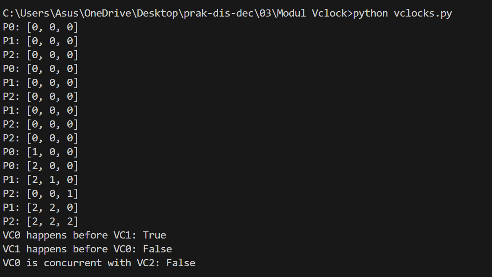<br>

Kemudian masukkan lagi file **"Main.py"**<br>
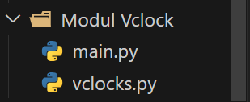<br>

Masukkan terminal untuk Main<br>
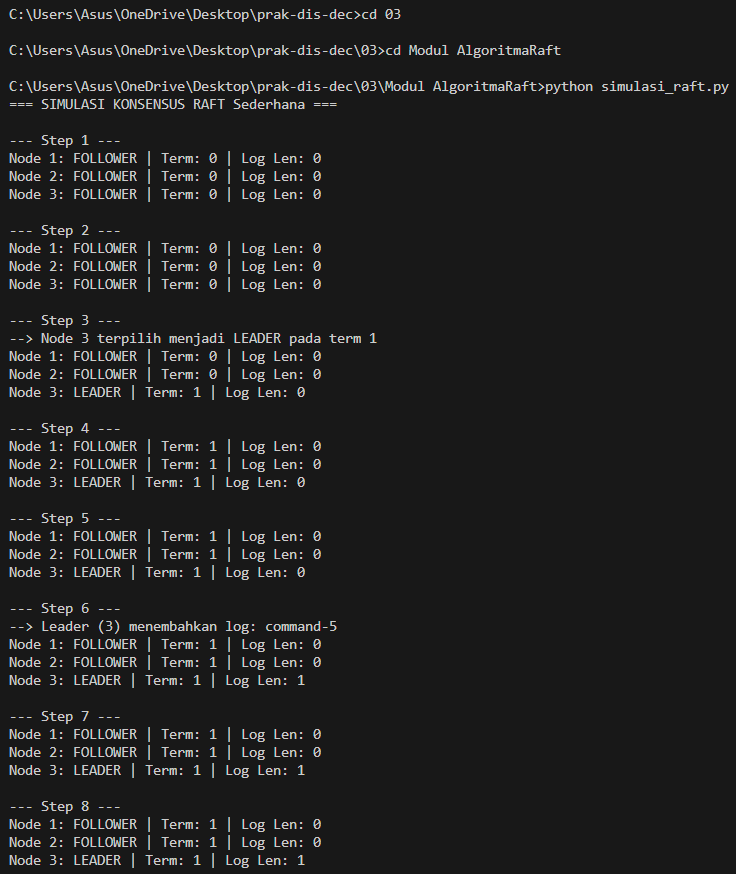<br>
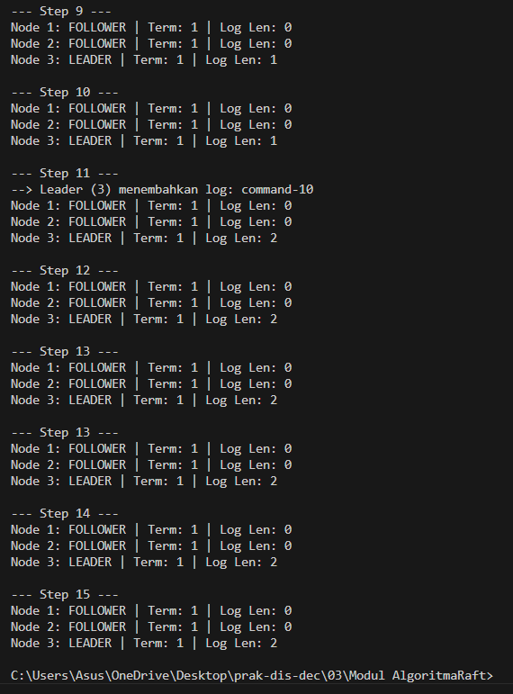<br>

Menambahkan file raft_Module.py dan simulasi_raft.py <br>
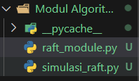<br>

## 3.3 Problem Tanpa Sinkronisasi

Menjalankan program : <br>
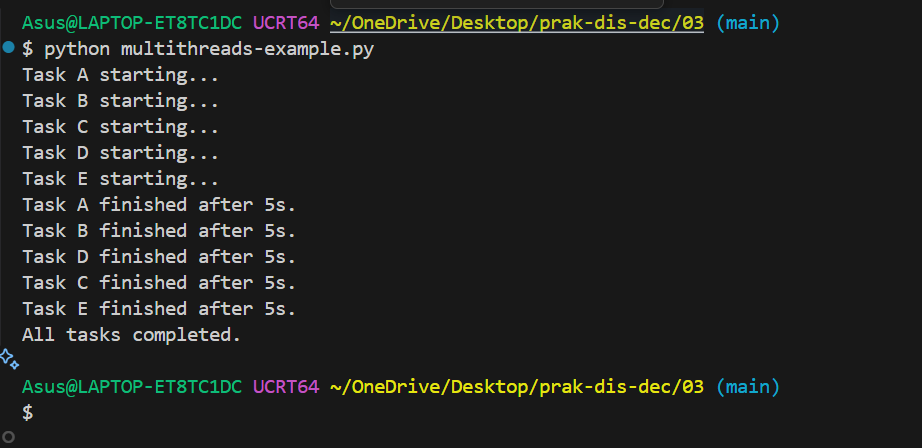<br>
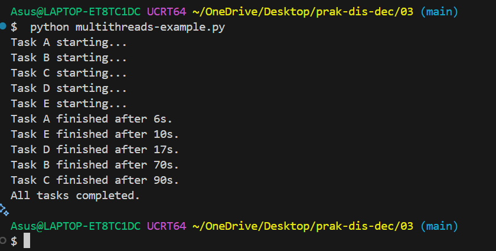<br>

Pembahasan :<br>
Pada output pertama, semua task selesai dalam waktu 5 detik karena memiliki durasi yang sama. Namun pada output kedua, setelah durasi tiap thread diubah menjadi bervariasi (A: 6s, B: 70s, C: 90s, D: 17s, E: 10s), urutan selesainya berubah menjadi A $\rightarrow$ E $\rightarrow$ D $\rightarrow$ B $\rightarrow$ C. Saya ubah angkanya untuk program angka untuk output kedua. Hal ini membuktikan sifat dasar multithreading yang asinkronus dan independen: task dengan durasi lebih singkat (seperti A dan E) akan selesai lebih dulu tanpa harus menunggu task yang durasinya lebih lama (seperti B dan C), dan total waktu running program ditentukan oleh thread yang paling lama (Task C = 90 detik).<br>

## 3.3.1 Data Race / Race Conditions

(race-conditions-01.py).<br>

Output :<br>

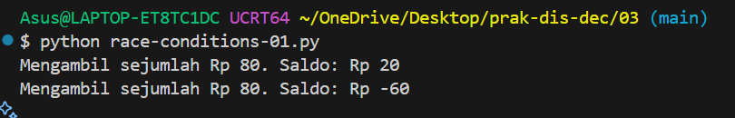<br>
Pembahasan : <br>

Hasil pengujian program race-conditions-01.py menunjukkan adanya kesalahan logika transaksi akibat ketiadaan pengunci variabel. Meskipun saldo awal yang dimiliki hanya sebesar Rp 100 dan setiap thread mencoba melakukan penarikan sebesar Rp 80, kedua transaksi tersebut secara tidak valid sama-sama berhasil dieksekusi. Kondisi ini menyebabkan saldo akhir bernilai tidak konsisten atau bernilai negatif.<br>

Penyebab utama dari data race ini adalah akses simultan oleh thread t1 dan t2 terhadap variabel global balance secara bersamaan. Saat t1 mengecek kondisi saldo, kriteria bernilai benar karena saldo masih terbaca Rp 100. Namun, jeda eksekusi pada time.sleep(0.01) memberi celah bagi t2 untuk membaca saldo yang belum diperbarui. Akibatnya, t2 membaca nilai saldo yang sama dan meloloskan penarikan kedua, sehingga konsistensi data saldo akhir menjadi rusak.<br>

(race-conditions-02.py).<br>

Output : <br>

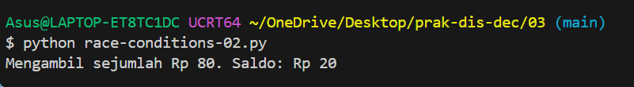<br>

Pembahasan : <br>

Hasil eksekusi program race-conditions-02.py menunjukkan bahwa penarikan hanya berhasil dilakukan satu kali, sehingga sisa saldo akhir tepat bernilai Rp 20. Kondisi race condition tidak terjadi karena penggunaan objek pengunci counter_lock = threading.Lock() melalui blok with counter_lock:. Mekanisme locking ini memastikan bahwasanya seluruh kode pemeriksaan dan pengurangan saldo (critical section) hanya dapat diakses oleh satu thread saja pada satu waktu. Ketika thread pertama masuk dan mengunci akses, thread kedua dipaksa menunggu hingga thread pertama selesai memperbarui nilai saldo. Begitu thread pertama selesai dan saldo tersisa Rp 20, thread kedua baru bisa masuk, namun gagal mengeksekusi penarikan karena kondisi balance >= amount ($20 \ge 80$) bernilai salah, sehingga konsistensi data saldo tetap terjaga.<br>

## 3.3.2 Deadlock

(deadlock-01.py): <br>

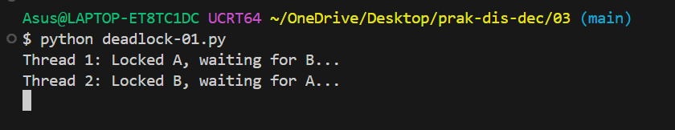<br>

Visualisasi menggunakan ballpoint : <br>
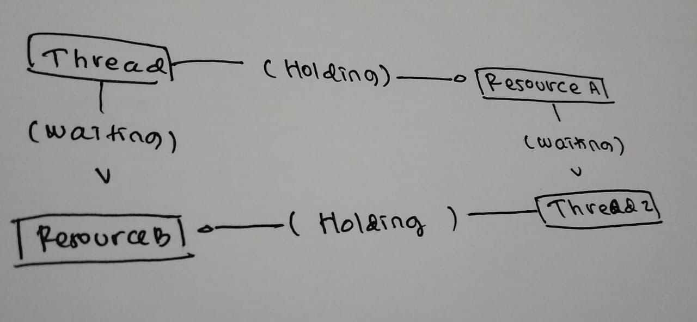<br>

Pembahasan : <br>

Berdasarkan hasil eksekusi program deadlock-01.py pada terminal, program mengalami kondisi Deadlock, yaitu situasi di mana dua atau lebih thread terhenti secara permanen (hang) karena saling menunggu resource yang dikunci oleh thread lainnya. Pada kasus ini, Thread 1 telah mengunci Resource A dan sedang menunggu untuk mengakses Resource B, sedangkan di saat yang sama Thread 2 telah mengunci Resource B dan sedang menunggu melepaskan Resource A. Situasi ini menciptakan ketergantungan melingkar (circular wait) serta memenuhi kondisi hold and wait, di mana tidak ada thread yang bersedia melepaskan resource yang sedang dipegangnya sebelum mendapatkan resource berikutnya. Akibatnya, program tidak akan pernah menyelesaikan prosesnya atau menampilkan output lanjutan sampai eksekusi dihentikan secara paksa menggunakan perintah Ctrl + C.<br>

(deadlock-02.py): <br>

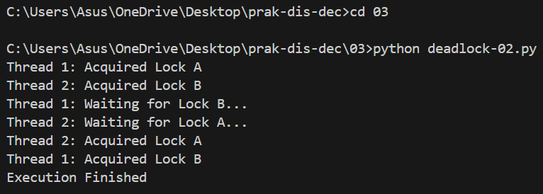<br>

Pembahasan : <br>

Deadlock tidak terjadi pada program deadlock-02.py karena kode tersebut menerapkan dua mekanisme utama pencegahan deadlock, yaitu pelepasan lock secara bertahap (release before request) dan penggunaan batas waktu (timeout). Pada kode tersebut, Thread 1 segera melepaskan Lock A di dalam blok finally setelah selesai melakukan simulasinya sebelum mencoba meminta Lock B. Begitu pula dengan Thread 2 yang melepaskan Lock B terlebih dahulu sebelum mencoba mengambil Lock A. Tindakan melepaskan lock pertama ini memutus kondisi Hold and Wait serta ketergantungan melingkar (Circular Wait), sehingga lock yang dibutuhkan oleh thread lain menjadi bebas dan dapat diakses secara bergantian hingga seluruh eksekusi selesai dengan sukses (Execution Finished). <br>

## 3.4 Algoritma Raft

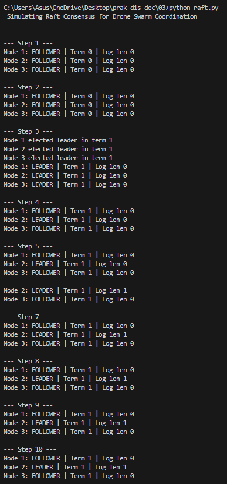<br>

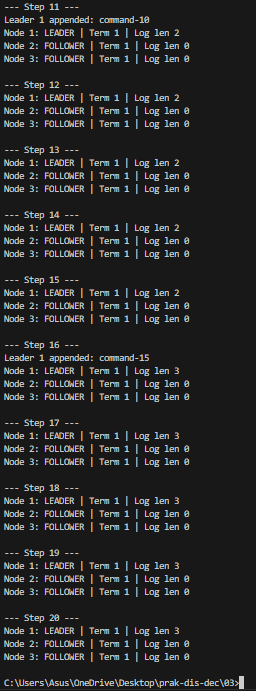<br>

Pembahasan : <br>

Berdasarkan hasil eksekusi simulasi algoritma Raft pada gambar, pada kondisi awal (Step 1-2) seluruh node (Node 1, Node 2, dan Node 3) berada pada peran FOLLOWER dengan nilai Term 0. Pada Step 3, waktu election timeout terlampaui sehingga node berpindah ke status CANDIDATE untuk menaikkan nilai Term menjadi 1 dan memulai proses pemilihan (election). Setelah mendapatkan dukungan suara mayoritas, node menetapkan dirinya sebagai LEADER.<br>

Pada Step 4-10, Node 2 bertindak sebagai pemimpin (LEADER) dan secara periodik mengirimkan sinyal heartbeat kepada Node 1 dan Node 3. Sinyal tersebut memaksa Node 1 dan Node 3 kembali serta bertahan pada peran FOLLOWER. Selama memimpin, Node 2 juga melakukan penambahan entri log (append entry). Selanjutnya pada Step 11-20, dinamika simulasi menunjukkan perpindahan kepemimpinan ke Node 1 yang mengambil alih peran LEADER pada Term 1 dan terus menambahkan entri log baru (seperti command-10 dan command-15) hingga akhir tahap eksekusi, sementara node lainnya tetap berada pada status FOLLOWER.<br>

Visualisasi menggunakan ballpoint : <br>

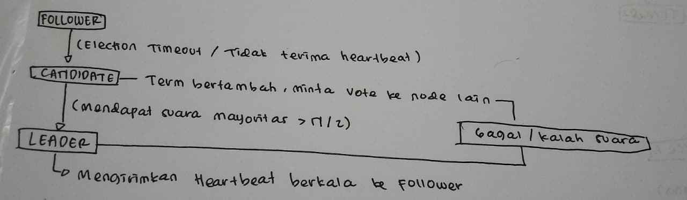<br>


