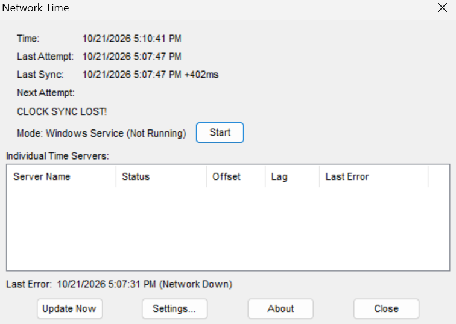
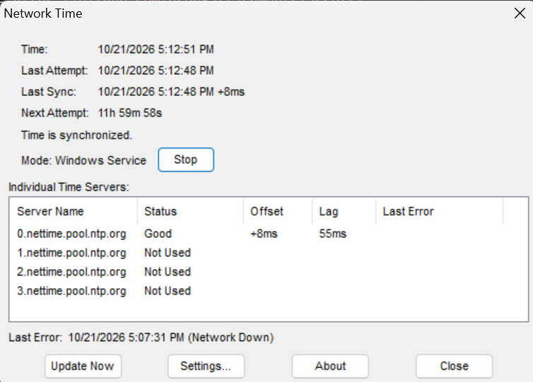
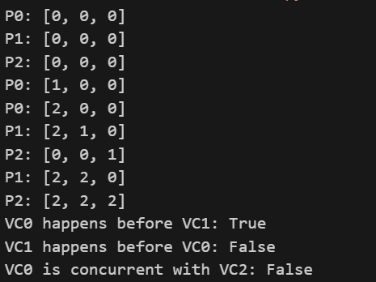

# PRAKTIKUM MINGGU 03

Nama : Dwi Ismi Andriani <br>
Nim : 255410012 <br>
Kelas : Informatika - 1 <br>

Laporan praktikum ke - 03 <br>
Topik : Sinkronisasi Pada Sistem Terdistribusi <br>

# TUJUAN

# DASAR TEORI

# PRAKTIK

## 3.1 Sinkronisasi Waktu

<<<<<<< HEAD

1. # Menginstall NetTime (Windows)<br>

    <br>

2. Menjelaskan proses sinkronisasi tersebut <br>
    <br>

   Setelah mengistal, tekan tombol next sampai ke tombol install <br>
    <br>

   Setelah sellesai seperti gambar disini, NetTime berarti sudah terinstall <br>
    <br>



Klik Start untuk menghidupkan



## 3.2 Vector Clock

1. Jalankan program tersebut, amati keluaran nya

```
class VectorClock:
    def __init__(self, num_processes, process_id):
        self.clocks = [0] * num_processes  # Initialize all clocks to zero
        self.process_id = process_id      # The ID of the current process

    def increment(self):
        """Increments the local clock for the current process."""
        self.clocks[self.process_id] += 1

    def send_message(self):
        """Prepares the vector clock for sending with a message."""
        self.increment()  # Increment local clock before sending
        return list(self.clocks) # Return a copy of the current vector clock

    def receive_message(self, received_clocks):
        """Updates the vector clock upon receiving a message."""
        for i in range(len(self.clocks)):
            self.clocks[i] = max(self.clocks[i], received_clocks[i])
        self.increment()  # Increment local clock after receiving and merging

    def __str__(self):
        return f"P{self.process_id}: {self.clocks}"

    def happens_before(self, other_vector_clock):
        """
        Determines if this vector clock happens before another.
        A happens before B if all elements in A are less than or equal to
        the corresponding elements in B, and at least one element in A is
        strictly less than the corresponding element in B.
        """
        if self.clocks == other_vector_clock.clocks:
            return False  # Same clocks, not "happens before"

        all_le = True  # All elements are less than or equal
        any_lt = False # At least one element is strictly less than

        for i in range(len(self.clocks)):
            if self.clocks[i] > other_vector_clock.clocks[i]:
                return False # Not "happens before" if any element is greater

            if self.clocks[i] < other_vector_clock.clocks[i]:
                any_lt = True

        return all_le and any_lt

    def is_concurrent(self, other_vector_clock):
        """
        Determines if two vector clocks are concurrent.
        Two events are concurrent if neither happens before the other.
        """
        return not (self.happens_before(other_vector_clock) or
                    other_vector_clock.happens_before(self))

# Simulate a system with 3 processes
vc0 = VectorClock(num_processes=3, process_id=0)
vc1 = VectorClock(num_processes=3, process_id=1)
vc2 = VectorClock(num_processes=3, process_id=2)

print(vc0)
print(vc1)
print(vc2)

# Process 0 performs a local event
vc0.increment()
print(vc0)

# Process 0 sends a message to Process 1
message_from_p0 = vc0.send_message()
vc1.receive_message(message_from_p0)
print(vc0)
print(vc1)

# Process 2 performs a local event
vc2.increment()
print(vc2)

# Process 1 sends a message to Process 2
message_from_p1 = vc1.send_message()
vc2.receive_message(message_from_p1)
print(vc1)
print(vc2)

# Check causality
print(f"VC0 happens before VC1: {vc0.happens_before(vc1)}")
print(f"VC1 happens before VC0: {vc1.happens_before(vc0)}")
print(f"VC0 is concurrent with VC2: {vc0.is_concurrent(vc2)}")
```

Output:


2. Buat modul Python untuk class VectorClock tersebut dan buatlah contoh cara menggunakan modul tersebut

Buat Folder **"Modul Vclock"**


Kemudian masukkan file **"vclocks.py"**

# TUGAS
