# PRAKTIKUM MINGGU 04

Nama : Dwi Ismi Andriani <br>
Nim : 255410012 <br>
Kelas : Informatika - 1 <br>

Laporan praktikum ke - 04 <br>
Topik : Konsistensi dan Replikasi pada Sistem Terdistribusi <br>

# TUJUAN

1. Memahami konsep konsistensi dan replikasi data pada sistem terdistribusi.
2. Mempraktikkan konfigurasi streaming replication menggunakan PostgreSQL dengan Docker.
3. Memahami perbedaan fungsi server primary dan replica pada PostgreSQL.
4. Memahami konsep High Availability (HA) dengan mempromosikan server replica menjadi primary.
5. Mempraktikkan konfigurasi replikasi master-master menggunakan Apache Ignite.
6. Menguji proses replikasi data antarnode melalui eksekusi perintah SQL.

# DASAR TEORI

Sistem terdistribusi merupakan sistem yang terdiri dari beberapa komputer atau server yang saling bekerja sama untuk mengelola dan bertukar data. Konsistensi dan replikasi merupakan konsep penting untuk menjaga kesesuaian data serta meningkatkan ketersediaan layanan.

### 1. Replikasi Data

Replikasi data adalah proses menyalin dan menyinkronkan data dari satu server ke server lain. Replikasi bertujuan menjaga ketersediaan data dan memungkinkan data yang sama diakses melalui beberapa server.

### 2. Streaming Replication PostgreSQL

Streaming replication merupakan mekanisme replikasi pada PostgreSQL yang menyalin perubahan data dari server primary ke server replica. Server primary menangani operasi baca dan tulis, sedangkan replica menyinkronkan data dan menyediakan akses baca.

### 3. High Availability (HA)

High Availability merupakan konsep untuk menjaga layanan tetap tersedia ketika terjadi gangguan pada server. Dalam praktikum ini, server replica dapat dipromosikan menjadi primary apabila server utama mengalami gangguan.

### 4. Replikasi Master-Master Apache Ignite

Replikasi master-master merupakan model replikasi yang memungkinkan node dalam cluster memiliki kemampuan sebagai primary untuk melakukan operasi baca dan tulis. Pada Apache Ignite, data yang dikelola dalam cluster dapat diakses melalui beberapa node.

### 5. Docker dan Docker Compose

Docker merupakan platform untuk menjalankan aplikasi dalam container, sedangkan Docker Compose digunakan untuk mengatur dan menjalankan beberapa container melalui satu file konfigurasi. Dalam praktikum ini, keduanya digunakan untuk menjalankan PostgreSQL dan Apache Ignite beserta node-node yang diperlukan.

## 4.1 Streaming Replication Menggunakan PostgreSQL

Membuat dua server database yang saling terhubung, yaitu server utama (primary) dan server cadangan (replica). Ketika data ditambahkan atau diubah di primary, perubahan tersebut akan direplikasi ke replica.<br>

Install Docker<br>

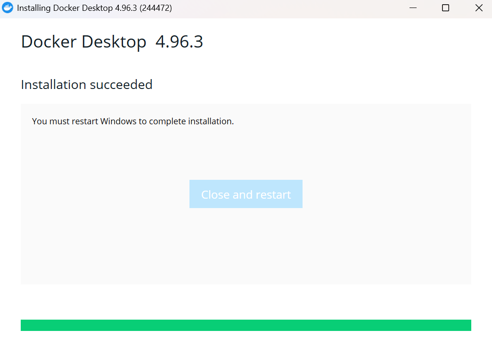 <br>

Pembahasan : <br>

Pada bagian ini, dilakukan persiapan lingkungan kerja (environment) berupa instalasi dan verifikasi Docker beserta Docker Compose sebagai prasyarat utama sebelum membangun arsitektur streaming replication PostgreSQL. Docker digunakan untuk mendistribusikan node primary dan node replica secara terisolasi di dalam kontainer terpisah pada satu mesin lokal. Proses diawali dengan melakukan instalasi Docker Engine serta Docker Desktop pada sistem operasi yang digunakan. Setelah proses instalasi selesai, daemon Docker (dockerd) diaktifkan agar layanan kontainerisasi dapat berjalan dan siap menerima perintah. Untuk memastikan bahwa Docker telah terpasang dengan benar dan mesin kontainer sudah beroperasi dengan status Engine running, dilakukan pengujian koneksi dan pengecekan status sistem menggunakan perintah docker info. Verifikasi ini penting dilakukan untuk menjamin seluruh komponen runtime Docker siap digunakan dalam menjalankan layanan cluster PostgreSQL melalui Docker Compose. <br>

## 4.1.1 Prasyarat

Memastikan Docker dan Docker Compose sudah terinstal serta layanan Docker aktif. <br>

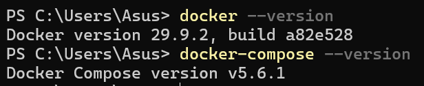 <br>

Pembahasan : <br>

Pada bagian 4.1.1 Prasyarat ini, dilakukan pengecekan lingkungan sistem untuk memastikan perangkat lunak pendukung utama, yaitu Docker Engine dan Docker Compose, telah terpasang dengan benar serta siap digunakan sebelum mengonfigurasi streaming replication pada PostgreSQL. Pengujian dilakukan dengan menjalankan perintah docker --version yang menghasilkan versi Docker 29.9.2 (build a82e528), serta perintah docker compose version yang menampilkan versi Docker Compose v5.6.1. Terverifikasinya kedua komponen ini menjamin bahwa sistem lokal telah memenuhi seluruh kebutuhan prasyarat untuk mengelola kontainer secara multi-container serta mengaktifkan daemon Docker (dockerd) dengan stabil selama proses praktikum berlangsung.<br>

## 4.1.2 Struktur Direktori dan FIle

Membuat 3 file :<br>

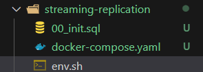 <br>

Pembahasan : <br>

Pada bagian 4.1.2 Struktur Direktori dan File, dilakukan penyiapan struktur direktori dan berkas konfigurasi utama di dalam folder proyek streaming-replication. Terdapat tiga berkas utama yang dibuat untuk mendukung jalannya arsitektur streaming replication PostgreSQL. Berkas pertama adalah 00_init.sql yang berisi perintah SQL untuk membuat user replikasi (replicator) serta physical replication slot (replication_slot) saat server primary diinisialisasi. Berkas kedua adalah docker-compose.yaml yang mendefinisikan service untuk node primary dan node replica, pemetaan port, environment variables, konfigurasi WAL (Write-Ahead Logging), hingga perintah otomatisasi sinkronisasi base backup. Terakhir, berkas env.sh disiapkan sebagai skrip shell yang berisi kumpulan alias perintah Docker untuk mempermudah eksekusi instruksi selama praktikum. Penyiapan ketiga berkas ini secara terstruktur menjamin seluruh proses kontainerisasi dan replikasi basis data berjalan konsisten serta terisolasi. <br>

## 4.1.3 Menjalankan docker-compose

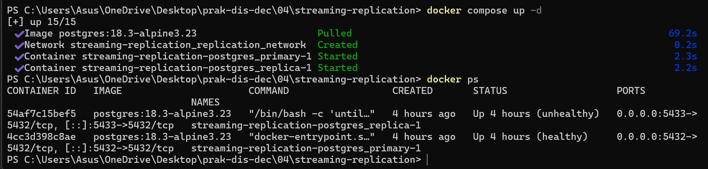<br>

Kemudian periksa kontainernya:<br>

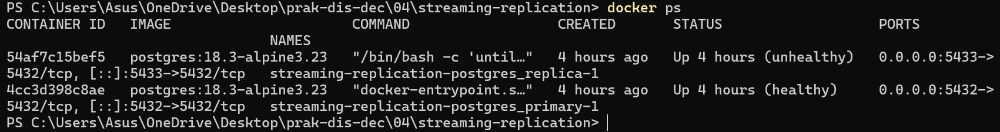<br>

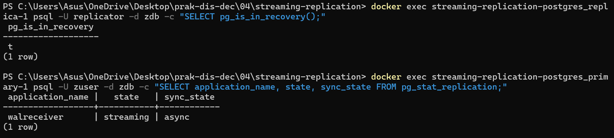<br>

Pembahasan : <br>

Pada praktikum ini, Docker Compose digunakan untuk menjalankan container PostgreSQL primary dan replica. Berdasarkan hasil perintah docker ps, kedua container berstatus healthy. Selain itu, pemeriksaan pg_stat_replication menunjukkan status streaming dengan mode replikasi async. Hal ini menunjukkan bahwa kedua container berjalan dengan baik dan proses streaming replication telah berhasil dilakukan.<br>

## 4.1.4 Pengujian

### 1. Menjalankan Container <br>

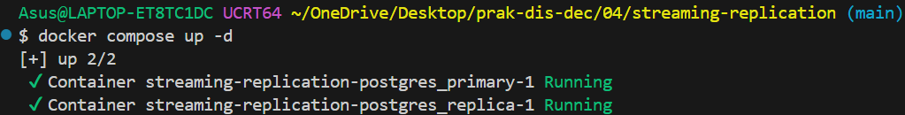<br>

Pembahasan : <br>

Proses inisialisasi layanan database dilakukan dengan menjalankan perintah `docker compose up -d`. Pada tahap ini, Docker Compose mengunduh image `postgres:18.3-alpine3.23` dan membentuk jaringan virtual `streaming-replication_replication_network`, lalu menjalankan dua container yaitu `postgres_primary` dan `postgres_replica` secara bersamaan di latar belakang.

### 2. Pastikan container sudah aktif dengan mengeceknya via:

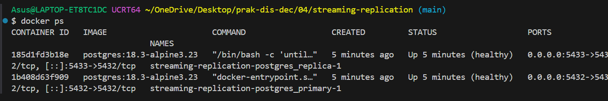<br>

Pembahasan : <br>

Pemeriksaan status container dilakukan menggunakan perintah `docker ps`. Hasil pemeriksaan menunjukkan bahwa container `streaming-replication-postgres_primary-1` dan `streaming-replication-postgres_replica-1` telah berstatus **Up (healthy)**. Hal ini menandakan bahwa kedua service database telah selesai diinisialisasi dan memenuhi kriteria pengujian kesehatan (_healthcheck_) yang ditentukan dalam file konfigurasi Docker Compose.

### 3. Masukkan perintah docker exec untuk masuk ke database primary:

<br>

Pembahasan : <br>

Perintah `docker exec -it` digunakan untuk membuka sesi interaktif ke dalam container `postgres_primary` melalui CLI `psql`. Dengan menentukan opsi `-U zuser` dan `-d zdb`, administrator dapat masuk secara langsung ke dalam basis data utama (_primary database_) untuk melakukan eksekusi perintah SQL atau memantau status sistem secara _real-time_.

### 4. Cek Status Replikasi di Primary Server

```
Asus@LAPTOP-ET8TC1DC UCRT64 ~/OneDrive/Desktop/prak-dis-dec/04/streaming-replication (main)
$ docker exec -it streaming-replication-postgres_primary-1 psql -U zuser -d zdb -c "\x" -c "SELECT * FROM pg_stat_replication;"
Expanded display is on.
-[ RECORD 1 ]----+------------------------------
pid              | 68
usesysid         | 16385
usename          | replicator
application_name | walreceiver
client_addr      | 172.18.0.3
client_hostname  |
client_port      | 42614
backend_start    | 2026-10-28 15:29:34.831691+00
backend_xmin     |
state            | streaming
sent_lsn         | 0/303BE38
write_lsn        | 0/303BE38
flush_lsn        | 0/303BE38
replay_lsn       | 0/303BE38
write_lag        |
flush_lag        |
replay_lag       |
--More--
```

<br>

Pembahasan : <br>

Pemeriksaan kueri `pg_stat_replication` pada node primary mengonfirmasi bahwa koneksi replikasi telah terjalin aktif. Nilai `usename = replicator` menunjukkan bahwa node replica terhubung menggunakan akun khusus replikasi, dan status `state = streaming` membuktikan bahwa transmisi data WAL <b>Write-Ahead Logging</b> dari primary ke replica berjalan secara berkelanjutan <b>real-time</b>. Selain itu, nilai LSN (`sent_lsn`, `write_lsn`, `flush_lsn`, `replay_lsn`) yang sama persis (`0/303BE38`) menandakan tidak ada jeda <b>lag zero</b> lag dalam sinkronisasi data.

### 5. Cek Status Recovery di Replica Server

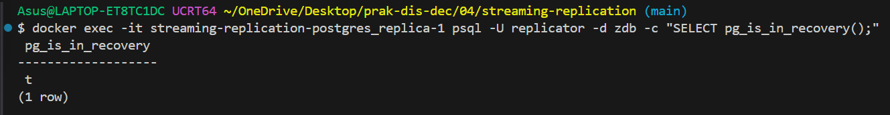<br>

Pembahasan : <br>

Pengujian status pada node replica dilakukan dengan memanggil fungsi `SELECT pg_is_in_recovery();`. Hasil keluaran mengembalikan nilai `t` (true), yang menandakan bahwa server PostgreSQL pada container replica memang beroperasi dalam mode <b>standby/recovery</b> _read-only_. Dalam mode ini, server berfokus menerima dan menerapkan catatan WAL dari node primary tanpa menerima operasi penulisan data langsung dari pengguna.

### 6. Uji Pengisian Data di Primary

```
Asus@LAPTOP-ET8TC1DC UCRT64 ~/OneDrive/Desktop/prak-dis-dec/04/streaming-replication (main)
$ docker exec -it streaming-replication-postgres_primary-1 psql -U zuser -d zdb
psql (18.3)
Type "help" for help.

zdb=# CREATE TABLE testrep (first INT, second VARCHAR(15));
ond) VALUES (23, 'Test ke dua');
SELECT * FROM testrep;
\qCREATE TABLE
zdb=# INSERT INTO testrep (first, second) VALUES (21, 'Test pertama');
INSERT 0 1
zdb=# INSERT INTO testrep (first, second) VALUES (23, 'Test ke dua');
INSERT 0 1
zdb=# SELECT * FROM testrep;
 first |    second
-------+--------------
    21 | Test pertama
    23 | Test ke dua
(2 rows)
```

<br>

Pembahasan : <br>

Pengujian manipulasi data dilakukan pada node primary dengan membuat tabel baru `testrep` dan memasukkan dua record data sampel. Keberhasilan perintah DDL (`CREATE TABLE`) dan DML (`INSERT INTO`) membuktikan bahwa node primary berfungsi penuh sebagai node _Read-Write_. Perubahan struktur serta isi data ini akan dicatat dalam file log WAL yang kemudian disiarkan <b>streaming</b> secara otomatis ke node replica untuk disinkronkan.

### 7. Verifikasi Data di Replica

### Sebelum Pembuatan Tabel

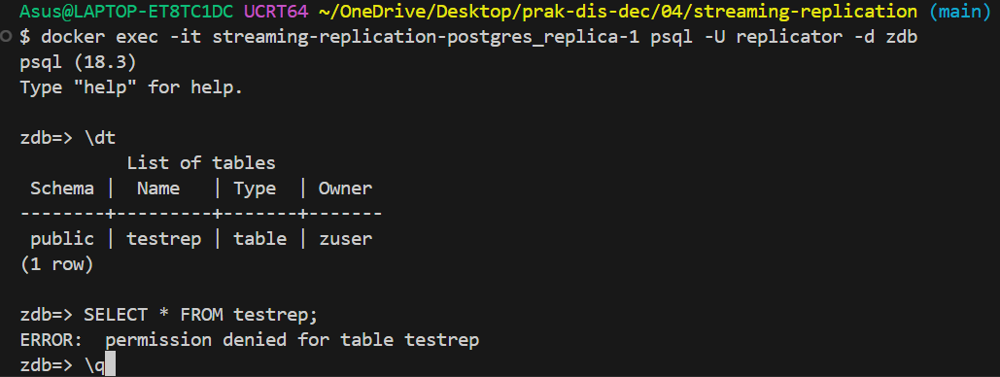<br>

Pembahasan : <br>

Menunjukkan kondisi awal server replica di mana belum ada tabel sama sekali (Did not find any tables.). Ini membuktikan bahwa replica benar-benar dalam keadaan bersih sebelum data ditambahkan di primary.

### Setelah Pembuatan Tabel & Sinkronisasi

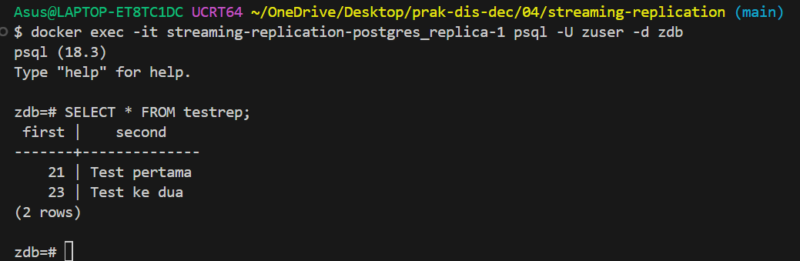<br>

Pembahasan : <br>

Menunjukkan kondisi replica setelah membuat tabel testrep dan mengisi datanya dari primary. Tampilan ini membuktikan bahwa proses streaming replication berhasil mereplikasi data secara real-time.

## 4.1.5 High-Availability

High-Availability (HA) pada konfigurasi _Streaming Replication_ memastikan ketersediaan sistem database tetap terjaga apabila node _primary_ mengalami kegagalan (_down_)[cite: 10, 11]. Pada kondisi ini, node _replica_ dapat dipromosikan menjadi node _primary_ baru menggunakan fungsi `SELECT pg_promote();`[cite: 11]. Proses promosi ini mengubah status _replica_ dari mode _read-only/standby_ (`pg_is_in_recovery() = true`) menjadi mode _read-write_ (`pg_is_in_recovery() = false`) sehingga layanan database dapat terus berjalan tanpa kehilangan data[cite: 8, 11].

#### Primary server mati

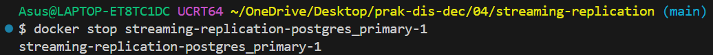<br>

Pembahasan : <br>

Perintah `docker stop` digunakan untuk menonaktifkan container `streaming-replication-postgres_primary-1`. Hal ini mensimulasikan skenario kegagalan sistem pada node utama untuk menguji ketahanan layanan (*High-Availability*).

#### Mempromosikan Replica Menjadi Primary

Memeriksa status mode recovery pada replica server, melakukan promosi menggunakan perintah `pg_promote()`, dan memverifikasi kembali statusnya: <br>

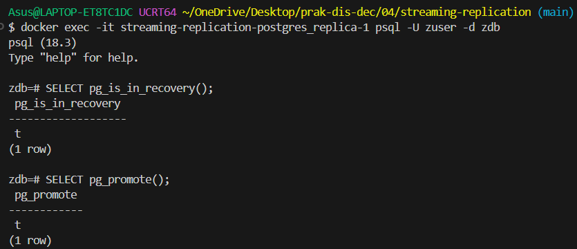<br>

Pembahasan : <br>

Sebelum dipromosikan, perintah `SELECT pg_is_in_recovery();` pada node replica menghasilkan nilai `true` (`t`) yang menunjukkan server berada dalam mode standby/read-only. Setelah dieksekusi perintah `SELECT pg_promote();`, node replica secara otomatis berubah peran menjadi primary server baru. Hal ini dibuktikan dengan hasil `pg_is_in_recovery()` yang berubah menjadi `false` (`f`), menandakan server kini telah siap menerima operasi Read-Write secara mandiri. <br>

Untuk mematikan semua primary dan replika:<br>

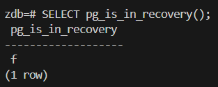<br>

# 4.2 Replikasi Master-Master Menggunakan Apache Ignite

## 4.2.1 Prasyarat
### 1. Persyarat
#### 1. Instalasi Docker telah dilaksanakan.

 <br>

#### 2. Instalansi Docker Compose Telah Dilaksanakan

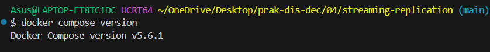 <br>

#### 3. Daemon dockerd telah diaktifkan

```
Asus@LAPTOP-ET8TC1DC UCRT64 ~/OneDrive/Desktop/prak-dis-dec/04/streaming-replication (main)
$ docker info
Client:
 Version:    29.9.2
 Context:    desktop-linux
 Debug Mode: false
 Plugins:
  agent: Docker AI Agent Runner (Docker Inc.)
    Version:  v1.152.0
    Path:     C:\Program Files\Docker\cli-plugins\docker-agent.exe
  ai: Docker AI Agent - Ask Gordon (Docker Inc.)
    Version:  v1.33.0
    Path:     C:\Program Files\Docker\cli-plugins\docker-ai.exe
  buildx: Docker Buildx (Docker Inc.)
    Version:  v0.38.1
    Path:     C:\Program Files\Docker\cli-plugins\docker-buildx.exe
  compose: Docker Compose (Docker Inc.)
    Version:  v5.6.1
    Path:     C:\Program Files\Docker\cli-plugins\docker-compose.exe
  debug: Get a shell into any image or container (Docker Inc.)
    Version:  0.49.0
    Path:     C:\Program Files\Docker\cli-plugins\docker-debug.exe
  desktop: Docker Desktop commands (Docker Inc.)
    Version:  4.96.3
    Path:     C:\Program Files\Docker\cli-plugins\docker-desktop.exe
  dhi: CLI for managing Docker Hardened Images (Docker Inc.)
    Version:  v0.0.9
    Path:     C:\Program Files\Docker\cli-plugins\docker-dhi.exe
  extension: Manages Docker extensions (Docker Inc.)
    Version:  v0.2.32
    Path:     C:\Program Files\Docker\cli-plugins\docker-extension.exe
  init: Creates Docker-related starter files for your project (Docker Inc.)
    Version:  v1.4.1
    Path:     C:\Program Files\Docker\cli-plugins\docker-init.exe
  mcp: Docker MCP Plugin (Docker Inc.)
    Version:  v0.44.2
    Path:     C:\Program Files\Docker\cli-plugins\docker-mcp.exe
  model: Docker Model Runner (Docker Inc.)
    Version:  v1.2.9
    Path:     C:\Program Files\Docker\cli-plugins\docker-model.exe
  offload: Docker Offload (Docker Inc.)
    Version:  v0.7.19
    Path:     C:\Program Files\Docker\cli-plugins\docker-offload.exe
  pass: Docker Pass Secrets Manager Plugin (beta) (Docker Inc.)
    Version:  v0.3.2
    Path:     C:\Program Files\Docker\cli-plugins\docker-pass.exe
  sandbox: "docker sandbox" is deprecated, use Docker Sandboxes instead (Docker Inc.)
    Version:  v0.13.0
    Path:     C:\Program Files\Docker\cli-plugins\docker-sandbox.exe
  scout: Docker Scout (Docker Inc.)
    Version:  v1.27.0
    Path:     C:\Program Files\Docker\cli-plugins\docker-scout.exe

Server:
 Containers: 2
  Running: 1
  Paused: 0
  Stopped: 1
 Images: 1
 Server Version: 29.9.2
 Storage Driver: overlayfs
  driver-type: io.containerd.snapshotter.v1
 Logging Driver: local
 Cgroup Driver: cgroupfs
 Cgroup Version: 2
 Plugins:
  Volume: local
  Network: bridge host ipvlan macvlan null overlay
  Log: awslogs fluentd gcplogs gelf journald json-file local splunk syslog
 CDI spec directories:
  /etc/cdi
  /var/run/cdi
 Discovered Devices:
  cdi: docker.com/gpu=webgpu
 Swarm: inactive
 Runtimes: io.containerd.runc.v2 nvidia runc
 Default Runtime: runc
 Init Binary: docker-init
 containerd version: b7a25261e029d68978bbf290df0a62fc819b3c51
 runc version: v1.5.2-0-g29dd3dc2
 init version: de40ad0
 Security Options:
  seccomp
   Profile: builtin
  cgroupns
 Kernel Version: 6.18.54.1-microsoft-standard-WSL2
 Operating System: Docker Desktop
 OSType: linux
 Architecture: x86_64
 CPUs: 8
 Total Memory: 7.576GiB
 Name: docker-desktop
 ID: 66b947b0-50b3-4ebd-a10f-3d952041cfc5
 Docker Root Dir: /var/lib/docker
 Debug Mode: false
 HTTP Proxy: http.docker.internal:3128
 HTTPS Proxy: http.docker.internal:3128
 No Proxy: hubproxy.docker.internal
 Labels:
  com.docker.desktop.address=npipe://\\.\pipe\docker_cli
 Experimental: false
 Insecure Registries:
  hubproxy.docker.internal:5555
  127.0.0.0/8
  ::1/128
 Live Restore Enabled: false
 Firewall Backend: iptables
```

Pembahasan : <br>


## 4.2.2. Struktur direktori dan file 

Menyiapkan struktur direktori kerja `ignite3-cluster` beserta berkas konfigurasi `docker-compose.yml`, folder dataset `sql`, dan berkas skrip `env.sh`:<br>

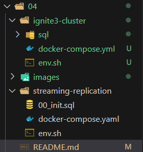 <br>

Nama berkas saya adalah docker-compose.yml (pakai .yml), sedangkan nama default di beberapa perintah adalah .yaml. Jadi saat menjalankan perintah docker compose, saya menambahkan : <br>

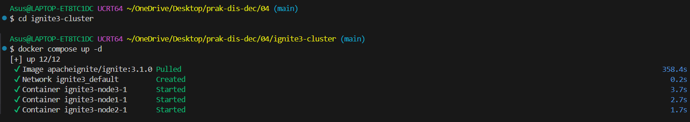 <br>

Docker akan otomatis membaca berkas docker-compose.yml tersebut <br>

Pembahasan : <br>

Pada tahap ini dilakukan penataan struktur direktori kerja khusus untuk kluster Apache Ignite 3.1.0 guna memisahkan lingkungan kerja dari modul sebelumnya. Berkas `docker-compose.yml` disiapkan untuk mendefinisikan tiga node layanan Apache Ignite. Selanjutnya, berkas arsip `sql.zip` diunduh dan diekstrak ke dalam folder `sql` yang berisi sekumpulan berkas DDL dan DML (`schema.sql`, `tracks.sql`, `invoices.sql`, dll) untuk kebutuhan pengisian basis data terdistribusi. Selain itu, berkas `env.sh` dibuat untuk menyimpan *alias* perintah Docker Compose dan Apache Ignite CLI agar mempermudah proses eksekusi CLI selama praktikum. <br>

## 4.2.3 Menjalankan docker-compose

Menjalankan 3 node cluster Apache Ignite 3.1.0 menggunakan Docker Compose serta mengecek status dan IP address dari masing-masing node: <br>

### 1. Menjalankan Layanan Cluster:

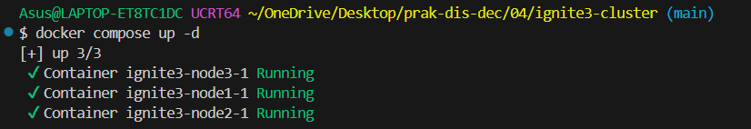 <br>

### 2. Memeriksa Status Container Active:

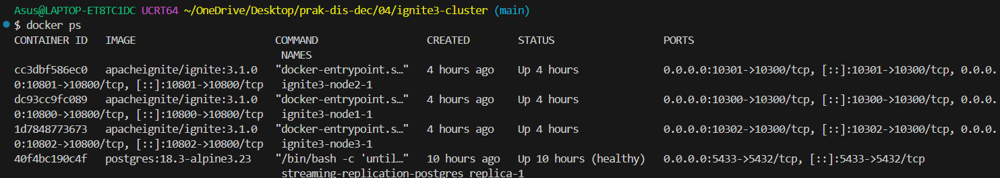 <br>

### 3. Memeriksa IP Address Masing-Masing Node:

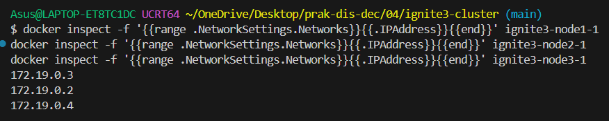 <br>

Pembahasan : <br>

Perintah `docker compose up -d` digunakan untuk mengunduh image `apacheignite/ignite:3.1.0` dari DockerHub dan mengaktifkan tiga container node (`ignite3-node1-1`, `ignite3-node2-1`, dan `ignite3-node3-1`). Berdasarkan hasil `docker ps`, ketiga node berjalan aktif dengan port REST API 10300, 10301, dan 10302 yang terbuka untuk manajemen administrative cluster. Selanjutnya, perintah `docker inspect` digunakan untuk mengidentifikasi alamat IP internal yang dialokasikan Docker pada setiap container node dalam jaringan virtual. <br>

## 4.2.4 Inisialisasi cluster 

Melakukan inisialisasi kluster Apache Ignite 3.1.0 dan memeriksa status kluster melalui Apache Ignite CLI: <br>

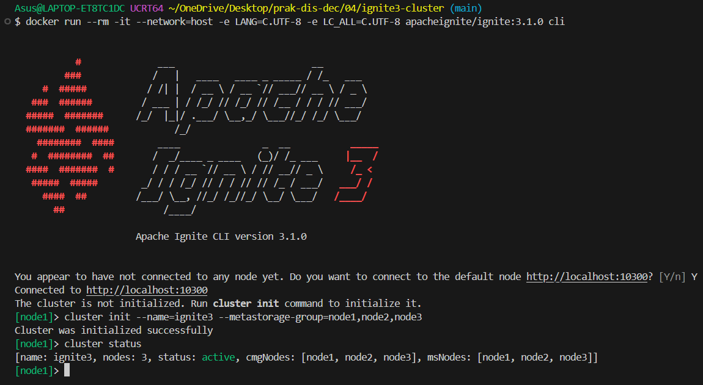 <br>

Pembahasan : <br>

Layanan Apache Ignite CLI dijalankan melalui container Docker untuk terhubung ke node utama (`http://localhost:10300`). Perintah `cluster init --name=ignite3 --metastorage-group=node1,node2,node3` dieksekusi untuk menginisialisasi grup metastorage terdistribusi pada ketiga node (`node1`, `node2`, dan `node3`). Setelah inisialisasi berhasil, perintah `cluster status` dijalankan untuk memverifikasi kondisi kluster. Output menunjukkan bahwa kluster bernama `ignite3` telah berada dalam status **`active`** dengan total 3 node yang saling terhubung dan siap memproses transaksi data.<br>

## 4.2.5 Eksekusi Perintah-Perintah SQL

Mengeksekusi skema basis data dan dataset sampel pada Node 1 serta memverifikasi propagasi replikasi terdistribusi pada Node 2 dan Node 3. <br>

### 1. Eksekusi Skema dan Dataset pada Node 1

Mengeksekusi berkas `schema.sql` beserta dataset DML pendukung melalui Ignite CLI yang telah di-mount dengan direktori lokal `./sql`:<br>

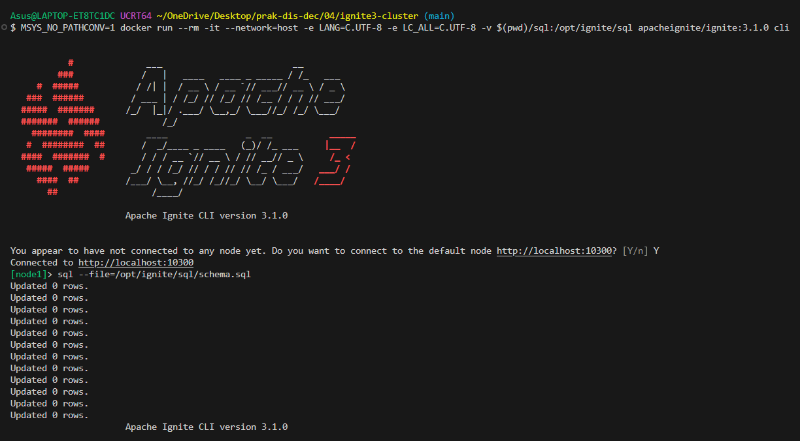 <br>

### 2. Eksekusi File SQL Dataset
```
[node1]> sql --file=/opt/ignite/sql/current_catalog.sql
Updated 275 rows.
Updated 347 rows.

[node1]> sql --file=/opt/ignite/sql/media_and_genre.sql
Updated 25 rows.
Updated 5 rows.

[node1]> sql --file=/opt/ignite/sql/tracks.sql
Updated 1000 rows.
Updated 1000 rows.
Updated 1000 rows.
Updated 503 rows.

[node1]> sql --file=/opt/ignite/sql/ee_and_cust.sql
Updated 8 rows.
Updated 59 rows.

[node1]> sql --file=/opt/ignite/sql/invoices.sql
Updated 412 rows.
Updated 1000 rows.
Updated 1000 rows.
Updated 240 rows.
Updated 18 rows.
Updated 1000 rows.
Updated 1000 rows.
Updated 1000 rows.
Updated 1000 rows.
Updated 1000 rows.
Updated 1000 rows.
Updated 1000 rows.
Updated 1000 rows.
Updated 715 rows.
```

### 3. Cek Daftar Tabel di Node 1

```
[node1]> sql
sql-cli> SELECT * FROM system.tables WHERE schema = 'PUBLIC';
╔═════════════╤═══════════════╤══════════╤═══════════════════╤═══════════════════╤═════════════════╤══════════════════════════╤═══════════╤═════════╤════════╤═══════════════╤════╤═════════════╤══════════════════════╤═══════════════════╗
║ SCHEMA_NAME │ TABLE_NAME    │ TABLE_ID │ TABLE_PK_INDEX_ID │ ZONE_NAME         │ STORAGE_PROFILE │ TABLE_COLOCATION_COLUMNS │ SCHEMA_ID │ ZONE_ID │ SCHEMA │ NAME          │ ID │ PK_INDEX_ID │ COLOCATION_KEY_INDEX │ ZONE              ║
╠═════════════╪═══════════════╪══════════╪═══════════════════╪═══════════════════╪═════════════════╪══════════════════════════╪═══════════╪═════════╪════════╪═══════════════╪════╪═════════════╪══════════════════════╪═══════════════════╣
║ PUBLIC      │ ALBUM         │ 22       │ 23                │ CHINOOK           │ default         │ ARTISTID                 │ 1         │ 20      │ PUBLIC │ ALBUM         │ 22 │ 23          │ ARTISTID             │ CHINOOK           ║
╟─────────────┼───────────────┼──────────┼───────────────────┼───────────────────┼─────────────────┼──────────────────────────┼───────────┼─────────┼────────┼───────────────┼────┼─────────────┼──────────────────────┼───────────────────╢
║ PUBLIC      │ PLAYLISTTRACK │ 40       │ 41                │ CHINOOK           │ default         │ PLAYLISTID, TRACKID      │ 1         │ 20      │ PUBLIC │ PLAYLISTTRACK │ 40 │ 41          │ PLAYLISTID, TRACKID  │ CHINOOK           ║
╟─────────────┼───────────────┼──────────┼───────────────────┼───────────────────┼─────────────────┼──────────────────────────┼───────────┼─────────┼────────┼───────────────┼────┼─────────────┼──────────────────────┼───────────────────╢
║ PUBLIC      │ TRACK         │ 42       │ 43                │ CHINOOK           │ default         │ ALBUMID                  │ 1         │ 20      │ PUBLIC │ TRACK         │ 42 │ 43          │ ALBUMID              │ CHINOOK           ║
╟─────────────┼───────────────┼──────────┼───────────────────┼───────────────────┼─────────────────┼──────────────────────────┼───────────┼─────────┼────────┼───────────────┼────┼─────────────┼──────────────────────┼───────────────────╢
║ PUBLIC      │ CUSTOMER      │ 26       │ 27                │ CHINOOK           │ default         │ CUSTOMERID               │ 1         │ 20      │ PUBLIC │ CUSTOMER      │ 26 │ 27          
│ CUSTOMERID           │ CHINOOK           ║
╟─────────────┼───────────────┼──────────┼───────────────────┼───────────────────┼─────────────────┼──────────────────────────┼───────────┼─────────┼────────┼───────────────┼────┼─────────────┼──────────────────────┼───────────────────╢
║ PUBLIC      │ MEDIATYPE     │ 36       │ 37                │ CHINOOKREPLICATED │ default         │ MEDIATYPEID              │ 1         │ 21      │ PUBLIC │ MEDIATYPE     │ 36 │ 37          
│ MEDIATYPEID          │ CHINOOKREPLICATED ║
╟─────────────┼───────────────┼──────────┼───────────────────┼───────────────────┼─────────────────┼──────────────────────────┼───────────┼─────────┼────────┼───────────────┼────┼─────────────┼──────────────────────┼───────────────────╢
║ PUBLIC      │ PLAYLIST      │ 38       │ 39                │ CHINOOK           │ default         │ PLAYLISTID               │ 1         │ 20      │ PUBLIC │ PLAYLIST      │ 38 │ 39          
│ PLAYLISTID           │ CHINOOK           ║
╟─────────────┼───────────────┼──────────┼───────────────────┼───────────────────┼─────────────────┼──────────────────────────┼───────────┼─────────┼────────┼───────────────┼────┼─────────────┼──────────────────────┼───────────────────╢
║ PUBLIC      │ ARTIST        │ 24       │ 25                │ CHINOOK           │ default         │ ARTISTID                 │ 1         │ 20      │ PUBLIC │ ARTIST        │ 24 │ 25          
│ ARTISTID             │ CHINOOK           ║
╟─────────────┼───────────────┼──────────┼───────────────────┼───────────────────┼─────────────────┼──────────────────────────┼───────────┼─────────┼────────┼───────────────┼────┼─────────────┼──────────────────────┼───────────────────╢
║ PUBLIC      │ INVOICELINE   │ 34       │ 35                │ CHINOOK           │ default         │ INVOICEID                │ 1         │ 20      │ PUBLIC │ INVOICELINE   │ 34 │ 35          
│ INVOICEID            │ CHINOOK           ║
╟─────────────┼───────────────┼──────────┼───────────────────┼───────────────────┼─────────────────┼──────────────────────────┼───────────┼─────────┼────────┼───────────────┼────┼─────────────┼──────────────────────┼───────────────────╢
║ PUBLIC      │ EMPLOYEE      │ 28       │ 29                │ CHINOOK           │ default         │ EMPLOYEEID               │ 1         │ 20      │ PUBLIC │ EMPLOYEE      │ 28 │ 29          
│ EMPLOYEEID           │ CHINOOK           ║
╟─────────────┼───────────────┼──────────┼───────────────────┼───────────────────┼─────────────────┼──────────────────────────┼───────────┼─────────┼────────┼───────────────┼────┼─────────────┼──────────────────────┼───────────────────╢
║ PUBLIC      │ GENRE         │ 30       │ 31                │ CHINOOKREPLICATED │ default         │ GENREID                  │ 1         │ 21      │ PUBLIC │ GENRE         │ 30 │ 31          
│ GENREID              │ CHINOOKREPLICATED ║
╟─────────────┼───────────────┼──────────┼───────────────────┼───────────────────┼─────────────────┼──────────────────────────┼───────────┼─────────┼────────┼───────────────┼────┼─────────────┼──────────────────────┼───────────────────╢
║ PUBLIC      │ INVOICE       │ 32       │ 33                │ CHINOOK           │ default         │ CUSTOMERID               │ 1         │ 20      │ PUBLIC │ INVOICE       │ 32 │ 33          
│ CUSTOMERID           │ CHINOOK           ║
╚═════════════╧═══════════════╧══════════╧═══════════════════╧═══════════════════╧═════════════════╧══════════════════════════╧═══════════╧═════════╧════════╧═══════════════╧════╧═════════════╧══════════════════════╧═══════════════════╝
```

### 4. Verifikasi Replikasi Pada Node 2

tabel hasil summary pendapatannya untuk bukti bahwa data dari Node 1 otomatis ada di Node 2. <br>

```
[node2]> sql
sql-cli> SELECT 
>     CAST(EXTRACT(YEAR FROM i.InvoiceDate) AS VARCHAR) || '-' || 
>     CASE 
>         WHEN EXTRACT(MONTH FROM i.InvoiceDate) < 10 
>         THEN '0' || CAST(EXTRACT(MONTH FROM i.InvoiceDate) AS VARCHAR) 
>         ELSE CAST(EXTRACT(MONTH FROM i.InvoiceDate) AS VARCHAR) 
>     END AS YearMonth,
>     COUNT(DISTINCT i.InvoiceId) AS InvoiceCount,
>     COUNT(DISTINCT i.CustomerId) AS CustomerCount,
>     SUM(i.Total) AS MonthlyRevenue,
>     AVG(i.Total) AS AverageOrderValue
> FROM 
>     Invoice i
> GROUP BY 
>     EXTRACT(YEAR FROM i.InvoiceDate), EXTRACT(MONTH FROM i.InvoiceDate)
> ORDER BY 
>     YearMonth DESC;
╔═══════════╤══════════════╤═══════════════╤════════════════╤════════════════════╗
║ YEARMONTH │ INVOICECOUNT │ CUSTOMERCOUNT │ MONTHLYREVENUE │ AVERAGEORDERVALUE  ║
╠═══════════╪══════════════╪═══════════════╪════════════════╪════════════════════╣
║ 2024-12   │ 7            │ 7             │ 38.62          │ 5.5171428571428571 ║
╟───────────┼──────────────┼───────────────┼────────────────┼────────────────────╢
║ 2024-11   │ 7            │ 7             │ 49.62          │ 7.0885714285714285 ║
╟───────────┼──────────────┼───────────────┼────────────────┼────────────────────╢
║ 2024-10   │ 7            │ 7             │ 37.62          │ 5.3742857142857142 ║
╟───────────┼──────────────┼───────────────┼────────────────┼────────────────────╢
║ 2024-09   │ 7            │ 7             │ 37.62          │ 5.3742857142857142 ║
╟───────────┼──────────────┼───────────────┼────────────────┼────────────────────╢
║ 2024-08   │ 7            │ 7             │ 37.62          │ 5.3742857142857142 ║
╟───────────┼──────────────┼───────────────┼────────────────┼────────────────────╢
║ 2024-07   │ 7            │ 7             │ 37.62          │ 5.3742857142857142 ║
╟───────────┼──────────────┼───────────────┼────────────────┼────────────────────╢
║ 2024-06   │ 7            │ 7             │ 37.62          │ 5.3742857142857142 ║
╟───────────┼──────────────┼───────────────┼────────────────┼────────────────────╢
║ 2024-05   │ 7            │ 7             │ 37.62          │ 5.3742857142857142 ║
╟───────────┼──────────────┼───────────────┼────────────────┼────────────────────╢
║ 2024-04   │ 5            │ 5             │ 33.66          │ 6.7320000000000000 ║
╟───────────┼──────────────┼───────────────┼────────────────┼────────────────────╢
║ 2024-03   │ 7            │ 7             │ 37.62          │ 5.3742857142857142 ║
╟───────────┼──────────────┼───────────────┼────────────────┼────────────────────╢
║ 2024-02   │ 5            │ 5             │ 27.72          │ 5.5440000000000000 ║
╟───────────┼──────────────┼───────────────┼────────────────┼────────────────────╢
║ 2024-01   │ 7            │ 7             │ 37.62          │ 5.3742857142857142 ║
╟───────────┼──────────────┼───────────────┼────────────────┼────────────────────╢
║ 2023-12   │ 7            │ 7             │ 37.62          │ 5.3742857142857142 ║
╟───────────┼──────────────┼───────────────┼────────────────┼────────────────────╢
║ 2023-11   │ 7            │ 7             │ 37.62          │ 5.3742857142857142 ║
╟───────────┼──────────────┼───────────────┼────────────────┼────────────────────╢
║ 2023-10   │ 7            │ 7             │ 42.62          │ 6.0885714285714285 ║
╟───────────┼──────────────┼───────────────┼────────────────┼────────────────────╢
║ 2023-09   │ 6            │ 6             │ 46.71          │ 7.7850000000000000 ║
╟───────────┼──────────────┼───────────────┼────────────────┼────────────────────╢
║ 2023-08   │ 7            │ 7             │ 47.62          │ 6.8028571428571428 ║
╟───────────┼──────────────┼───────────────┼────────────────┼────────────────────╢
║ 2023-07   │ 7            │ 7             │ 39.62          │ 5.6600000000000000 ║
╟───────────┼──────────────┼───────────────┼────────────────┼────────────────────╢
║ 2023-06   │ 7            │ 7             │ 37.62          │ 5.3742857142857142 ║
╟───────────┼──────────────┼───────────────┼────────────────┼────────────────────╢
║ 2023-05   │ 7            │ 7             │ 37.62          │ 5.3742857142857142 ║
╟───────────┼──────────────┼───────────────┼────────────────┼────────────────────╢
║ 2023-04   │ 7            │ 7             │ 37.62          │ 5.3742857142857142 ║
╟───────────┼──────────────┼───────────────┼────────────────┼────────────────────╢
║ 2023-03   │ 7            │ 7             │ 37.62          │ 5.3742857142857142 ║
╟───────────┼──────────────┼───────────────┼────────────────┼────────────────────╢
║ 2023-02   │ 7            │ 7             │ 37.62          │ 5.3742857142857142 ║
╟───────────┼──────────────┼───────────────┼────────────────┼────────────────────╢
║ 2023-01   │ 7            │ 7             │ 37.62          │ 5.3742857142857142 ║
╟───────────┼──────────────┼───────────────┼────────────────┼────────────────────╢
║ 2022-12   │ 7            │ 7             │ 37.62          │ 5.3742857142857142 ║
╟───────────┼──────────────┼───────────────┼────────────────┼────────────────────╢
║ 2022-11   │ 6            │ 6             │ 23.76          │ 3.9600000000000000 ║
╟───────────┼──────────────┼───────────────┼────────────────┼────────────────────╢
║ 2022-10   │ 7            │ 7             │ 37.62          │ 5.3742857142857142 ║
╟───────────┼──────────────┼───────────────┼────────────────┼────────────────────╢
║ 2022-09   │ 7            │ 7             │ 37.62          │ 5.3742857142857142 ║
╟───────────┼──────────────┼───────────────┼────────────────┼────────────────────╢
║ 2022-08   │ 7            │ 7             │ 37.62          │ 5.3742857142857142 ║
╟───────────┼──────────────┼───────────────┼────────────────┼────────────────────╢
║ 2022-07   │ 7            │ 7             │ 37.62          │ 5.3742857142857142 ║
╟───────────┼──────────────┼───────────────┼────────────────┼────────────────────╢
║ 2022-06   │ 7            │ 7             │ 50.62          │ 7.2314285714285714 ║
╟───────────┼──────────────┼───────────────┼────────────────┼────────────────────╢
║ 2022-05   │ 7            │ 7             │ 42.62          │ 6.0885714285714285 ║
╟───────────┼──────────────┼───────────────┼────────────────┼────────────────────╢
║ 2022-04   │ 7            │ 7             │ 51.62          │ 7.3742857142857142 ║
╟───────────┼──────────────┼───────────────┼────────────────┼────────────────────╢
║ 2022-03   │ 7            │ 7             │ 37.62          │ 5.3742857142857142 ║
╟───────────┼──────────────┼───────────────┼────────────────┼────────────────────╢
║ 2022-02   │ 7            │ 7             │ 37.62          │ 5.3742857142857142 ║
╟───────────┼──────────────┼───────────────┼────────────────┼────────────────────╢
║ 2022-01   │ 7            │ 7             │ 37.62          │ 5.3742857142857142 ║
╟───────────┼──────────────┼───────────────┼────────────────┼────────────────────╢
║ 2021-12   │ 7            │ 7             │ 37.62          │ 5.3742857142857142 ║
╟───────────┼──────────────┼───────────────┼────────────────┼────────────────────╢
║ 2021-11   │ 7            │ 7             │ 37.62          │ 5.3742857142857142 ║
╟───────────┼──────────────┼───────────────┼────────────────┼────────────────────╢
║ 2021-10   │ 7            │ 7             │ 37.62          │ 5.3742857142857142 ║
╟───────────┼──────────────┼───────────────┼────────────────┼────────────────────╢
║ 2021-09   │ 6            │ 6             │ 36.63          │ 6.1050000000000000 ║
╟───────────┼──────────────┼───────────────┼────────────────┼────────────────────╢
║ 2021-08   │ 7            │ 7             │ 37.62          │ 5.3742857142857142 ║
╟───────────┼──────────────┼───────────────┼────────────────┼────────────────────╢
║ 2021-07   │ 7            │ 7             │ 37.62          │ 5.3742857142857142 ║
╟───────────┼──────────────┼───────────────┼────────────────┼────────────────────╢
║ 2021-06   │ 7            │ 7             │ 37.62          │ 5.3742857142857142 ║
╟───────────┼──────────────┼───────────────┼────────────────┼────────────────────╢
║ 2021-05   │ 7            │ 7             │ 37.62          │ 5.3742857142857142 ║
╟───────────┼──────────────┼───────────────┼────────────────┼────────────────────╢
║ 2021-04   │ 7            │ 7             │ 37.62          │ 5.3742857142857142 ║
╟───────────┼──────────────┼───────────────┼────────────────┼────────────────────╢
║ 2021-03   │ 7            │ 7             │ 44.62          │ 6.3742857142857142 ║
╟───────────┼──────────────┼───────────────┼────────────────┼────────────────────╢
║ 2021-02   │ 7            │ 7             │ 46.62          │ 6.6600000000000000 ║
╟───────────┼──────────────┼───────────────┼────────────────┼────────────────────╢
║ 2021-01   │ 7            │ 7             │ 52.62          │ 7.5171428571428571 ║
╟───────────┼──────────────┼───────────────┼────────────────┼────────────────────╢
║ 2020-12   │ 7            │ 7             │ 37.62          │ 5.3742857142857142 ║
╟───────────┼──────────────┼───────────────┼────────────────┼────────────────────╢
║ 2020-11   │ 7            │ 7             │ 37.62          │ 5.3742857142857142 ║
╟───────────┼──────────────┼───────────────┼────────────────┼────────────────────╢
║ 2020-10   │ 7            │ 7             │ 37.62          │ 5.3742857142857142 ║
╟───────────┼──────────────┼───────────────┼────────────────┼────────────────────╢
║ 2020-09   │ 7            │ 7             │ 37.62          │ 5.3742857142857142 ║
╟───────────┼──────────────┼───────────────┼────────────────┼────────────────────╢
║ 2020-08   │ 7            │ 7             │ 37.62          │ 5.3742857142857142 ║
╟───────────┼──────────────┼───────────────┼────────────────┼────────────────────╢
║ 2020-07   │ 7            │ 7             │ 37.62          │ 5.3742857142857142 ║
╟───────────┼──────────────┼───────────────┼────────────────┼────────────────────╢
║ 2020-06   │ 7            │ 7             │ 37.62          │ 5.3742857142857142 ║
╟───────────┼──────────────┼───────────────┼────────────────┼────────────────────╢
║ 2020-05   │ 7            │ 7             │ 37.62          │ 5.3742857142857142 ║
╟───────────┼──────────────┼───────────────┼────────────────┼────────────────────╢
║ 2020-04   │ 7            │ 7             │ 37.62          │ 5.3742857142857142 ║
╟───────────┼──────────────┼───────────────┼────────────────┼────────────────────╢
║ 2020-03   │ 7            │ 7             │ 37.62          │ 5.3742857142857142 ║
╟───────────┼──────────────┼───────────────┼────────────────┼────────────────────╢
║ 2020-02   │ 7            │ 7             │ 37.62          │ 5.3742857142857142 ║
╟───────────┼──────────────┼───────────────┼────────────────┼────────────────────╢
║ 2020-01   │ 6            │ 6             │ 35.64          │ 5.9400000000000000 ║
╚═══════════╧══════════════╧═══════════════╧════════════════╧════════════════════╝
```

 ### 5. Verifikasi Replikasi pada Node 3

```
[node3]> sql
sql-cli> SELECT 
>     CAST(EXTRACT(YEAR FROM i.InvoiceDate) AS VARCHAR) || '-' ||
>     CASE
>         WHEN EXTRACT(MONTH FROM i.InvoiceDate) < 10
>         THEN '0' || CAST(EXTRACT(MONTH FROM i.InvoiceDate) AS VARCHAR)
>         ELSE CAST(EXTRACT(MONTH FROM i.InvoiceDate) AS VARCHAR)
>     END AS YearMonth,
>     COUNT(DISTINCT i.InvoiceId) AS InvoiceCount,
>     COUNT(DISTINCT i.CustomerId) AS CustomerCount,
>     SUM(i.Total) AS MonthlyRevenue,
>     AVG(i.Total) AS AverageOrderValue
> FROM
>     Invoice i
> GROUP BY
>     EXTRACT(YEAR FROM i.InvoiceDate), EXTRACT(MONTH FROM i.InvoiceDate)
> ORDER BY
>     YearMonth DESC;
╔═══════════╤══════════════╤═══════════════╤════════════════╤════════════════════╗
║ YEARMONTH │ INVOICECOUNT │ CUSTOMERCOUNT │ MONTHLYREVENUE │ AVERAGEORDERVALUE  ║
╠═══════════╪══════════════╪═══════════════╪════════════════╪════════════════════╣
║ 2024-12   │ 7            │ 7             │ 38.62          │ 5.5171428571428571 ║
╟───────────┼──────────────┼───────────────┼────────────────┼────────────────────╢
║ 2024-11   │ 7            │ 7             │ 49.62          │ 7.0885714285714285 ║
╟───────────┼──────────────┼───────────────┼────────────────┼────────────────────╢
║ 2024-10   │ 7            │ 7             │ 37.62          │ 5.3742857142857142 ║
╟───────────┼──────────────┼───────────────┼────────────────┼────────────────────╢
║ 2024-09   │ 7            │ 7             │ 37.62          │ 5.3742857142857142 ║
╟───────────┼──────────────┼───────────────┼────────────────┼────────────────────╢
║ 2024-08   │ 7            │ 7             │ 37.62          │ 5.3742857142857142 ║
╟───────────┼──────────────┼───────────────┼────────────────┼────────────────────╢
║ 2024-07   │ 7            │ 7             │ 37.62          │ 5.3742857142857142 ║
╟───────────┼──────────────┼───────────────┼────────────────┼────────────────────╢
║ 2024-06   │ 7            │ 7             │ 37.62          │ 5.3742857142857142 ║
╟───────────┼──────────────┼───────────────┼────────────────┼────────────────────╢
║ 2024-05   │ 7            │ 7             │ 37.62          │ 5.3742857142857142 ║
╟───────────┼──────────────┼───────────────┼────────────────┼────────────────────╢
║ 2024-04   │ 5            │ 5             │ 33.66          │ 6.7320000000000000 ║
╟───────────┼──────────────┼───────────────┼────────────────┼────────────────────╢
║ 2024-03   │ 7            │ 7             │ 37.62          │ 5.3742857142857142 ║
╟───────────┼──────────────┼───────────────┼────────────────┼────────────────────╢
║ 2024-02   │ 5            │ 5             │ 27.72          │ 5.5440000000000000 ║
╟───────────┼──────────────┼───────────────┼────────────────┼────────────────────╢
║ 2024-01   │ 7            │ 7             │ 37.62          │ 5.3742857142857142 ║
╟───────────┼──────────────┼───────────────┼────────────────┼────────────────────╢
║ 2023-12   │ 7            │ 7             │ 37.62          │ 5.3742857142857142 ║
╟───────────┼──────────────┼───────────────┼────────────────┼────────────────────╢
║ 2023-11   │ 7            │ 7             │ 37.62          │ 5.3742857142857142 ║
╟───────────┼──────────────┼───────────────┼────────────────┼────────────────────╢
║ 2023-10   │ 7            │ 7             │ 42.62          │ 6.0885714285714285 ║
╟───────────┼──────────────┼───────────────┼────────────────┼────────────────────╢
║ 2023-09   │ 6            │ 6             │ 46.71          │ 7.7850000000000000 ║
╟───────────┼──────────────┼───────────────┼────────────────┼────────────────────╢
║ 2023-08   │ 7            │ 7             │ 47.62          │ 6.8028571428571428 ║
╟───────────┼──────────────┼───────────────┼────────────────┼────────────────────╢
║ 2023-07   │ 7            │ 7             │ 39.62          │ 5.6600000000000000 ║
╟───────────┼──────────────┼───────────────┼────────────────┼────────────────────╢
║ 2023-06   │ 7            │ 7             │ 37.62          │ 5.3742857142857142 ║
╟───────────┼──────────────┼───────────────┼────────────────┼────────────────────╢
║ 2023-05   │ 7            │ 7             │ 37.62          │ 5.3742857142857142 ║
╟───────────┼──────────────┼───────────────┼────────────────┼────────────────────╢
║ 2023-04   │ 7            │ 7             │ 37.62          │ 5.3742857142857142 ║
╟───────────┼──────────────┼───────────────┼────────────────┼────────────────────╢
║ 2023-03   │ 7            │ 7             │ 37.62          │ 5.3742857142857142 ║
╟───────────┼──────────────┼───────────────┼────────────────┼────────────────────╢
║ 2023-02   │ 7            │ 7             │ 37.62          │ 5.3742857142857142 ║
╟───────────┼──────────────┼───────────────┼────────────────┼────────────────────╢
║ 2023-01   │ 7            │ 7             │ 37.62          │ 5.3742857142857142 ║
╟───────────┼──────────────┼───────────────┼────────────────┼────────────────────╢
║ 2022-12   │ 7            │ 7             │ 37.62          │ 5.3742857142857142 ║
╟───────────┼──────────────┼───────────────┼────────────────┼────────────────────╢
║ 2022-11   │ 6            │ 6             │ 23.76          │ 3.9600000000000000 ║
╟───────────┼──────────────┼───────────────┼────────────────┼────────────────────╢
║ 2022-10   │ 7            │ 7             │ 37.62          │ 5.3742857142857142 ║
╟───────────┼──────────────┼───────────────┼────────────────┼────────────────────╢
║ 2022-09   │ 7            │ 7             │ 37.62          │ 5.3742857142857142 ║
╟───────────┼──────────────┼───────────────┼────────────────┼────────────────────╢
║ 2022-08   │ 7            │ 7             │ 37.62          │ 5.3742857142857142 ║
╟───────────┼──────────────┼───────────────┼────────────────┼────────────────────╢
║ 2022-07   │ 7            │ 7             │ 37.62          │ 5.3742857142857142 ║
╟───────────┼──────────────┼───────────────┼────────────────┼────────────────────╢
║ 2022-06   │ 7            │ 7             │ 50.62          │ 7.2314285714285714 ║
╟───────────┼──────────────┼───────────────┼────────────────┼────────────────────╢
║ 2022-05   │ 7            │ 7             │ 42.62          │ 6.0885714285714285 ║
╟───────────┼──────────────┼───────────────┼────────────────┼────────────────────╢
║ 2022-04   │ 7            │ 7             │ 51.62          │ 7.3742857142857142 ║
╟───────────┼──────────────┼───────────────┼────────────────┼────────────────────╢
║ 2022-03   │ 7            │ 7             │ 37.62          │ 5.3742857142857142 ║
╟───────────┼──────────────┼───────────────┼────────────────┼────────────────────╢
║ 2022-02   │ 7            │ 7             │ 37.62          │ 5.3742857142857142 ║
╟───────────┼──────────────┼───────────────┼────────────────┼────────────────────╢
║ 2022-01   │ 7            │ 7             │ 37.62          │ 5.3742857142857142 ║
╟───────────┼──────────────┼───────────────┼────────────────┼────────────────────╢
║ 2021-12   │ 7            │ 7             │ 37.62          │ 5.3742857142857142 ║
╟───────────┼──────────────┼───────────────┼────────────────┼────────────────────╢
║ 2021-11   │ 7            │ 7             │ 37.62          │ 5.3742857142857142 ║
╟───────────┼──────────────┼───────────────┼────────────────┼────────────────────╢
║ 2021-10   │ 7            │ 7             │ 37.62          │ 5.3742857142857142 ║
╟───────────┼──────────────┼───────────────┼────────────────┼────────────────────╢
║ 2021-09   │ 6            │ 6             │ 36.63          │ 6.1050000000000000 ║
╟───────────┼──────────────┼───────────────┼────────────────┼────────────────────╢
║ 2021-08   │ 7            │ 7             │ 37.62          │ 5.3742857142857142 ║
╟───────────┼──────────────┼───────────────┼────────────────┼────────────────────╢
║ 2021-07   │ 7            │ 7             │ 37.62          │ 5.3742857142857142 ║
╟───────────┼──────────────┼───────────────┼────────────────┼────────────────────╢
║ 2021-06   │ 7            │ 7             │ 37.62          │ 5.3742857142857142 ║
╟───────────┼──────────────┼───────────────┼────────────────┼────────────────────╢
║ 2021-05   │ 7            │ 7             │ 37.62          │ 5.3742857142857142 ║
╟───────────┼──────────────┼───────────────┼────────────────┼────────────────────╢
║ 2021-04   │ 7            │ 7             │ 37.62          │ 5.3742857142857142 ║
╟───────────┼──────────────┼───────────────┼────────────────┼────────────────────╢
║ 2021-03   │ 7            │ 7             │ 44.62          │ 6.3742857142857142 ║
╟───────────┼──────────────┼───────────────┼────────────────┼────────────────────╢
║ 2021-02   │ 7            │ 7             │ 46.62          │ 6.6600000000000000 ║
╟───────────┼──────────────┼───────────────┼────────────────┼────────────────────╢
║ 2021-01   │ 7            │ 7             │ 52.62          │ 7.5171428571428571 ║
╟───────────┼──────────────┼───────────────┼────────────────┼────────────────────╢
║ 2020-12   │ 7            │ 7             │ 37.62          │ 5.3742857142857142 ║
╟───────────┼──────────────┼───────────────┼────────────────┼────────────────────╢
║ 2020-11   │ 7            │ 7             │ 37.62          │ 5.3742857142857142 ║
╟───────────┼──────────────┼───────────────┼────────────────┼────────────────────╢
║ 2020-10   │ 7            │ 7             │ 37.62          │ 5.3742857142857142 ║
╟───────────┼──────────────┼───────────────┼────────────────┼────────────────────╢
║ 2020-09   │ 7            │ 7             │ 37.62          │ 5.3742857142857142 ║
╟───────────┼──────────────┼───────────────┼────────────────┼────────────────────╢
║ 2020-08   │ 7            │ 7             │ 37.62          │ 5.3742857142857142 ║
╟───────────┼──────────────┼───────────────┼────────────────┼────────────────────╢
║ 2020-07   │ 7            │ 7             │ 37.62          │ 5.3742857142857142 ║
╟───────────┼──────────────┼───────────────┼────────────────┼────────────────────╢
║ 2020-06   │ 7            │ 7             │ 37.62          │ 5.3742857142857142 ║
╟───────────┼──────────────┼───────────────┼────────────────┼────────────────────╢
║ 2020-05   │ 7            │ 7             │ 37.62          │ 5.3742857142857142 ║
╟───────────┼──────────────┼───────────────┼────────────────┼────────────────────╢
║ 2020-04   │ 7            │ 7             │ 37.62          │ 5.3742857142857142 ║
╟───────────┼──────────────┼───────────────┼────────────────┼────────────────────╢
║ 2020-03   │ 7            │ 7             │ 37.62          │ 5.3742857142857142 ║
╟───────────┼──────────────┼───────────────┼────────────────┼────────────────────╢
║ 2020-02   │ 7            │ 7             │ 37.62          │ 5.3742857142857142 ║
╟───────────┼──────────────┼───────────────┼────────────────┼────────────────────╢
║ 2020-01   │ 6            │ 6             │ 35.64          │ 5.9400000000000000 ║
╚═══════════╧══════════════╧═══════════════╧════════════════╧════════════════════╝
```
 


