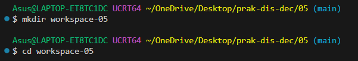
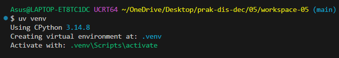
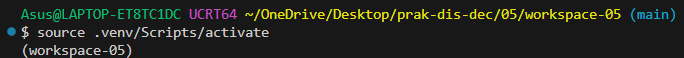
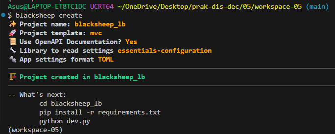
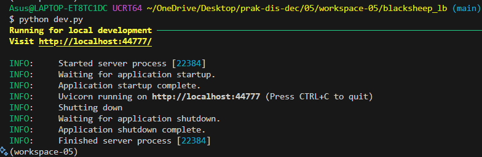

# PRAKTIKUM MINGGU 05

Nama : Dwi Ismi Andriani <br>
Nim : 255410012 <br>
Kelas : Informatika - 1 <br>

Laporan praktikum ke - 05 <br>
Topik : Fault Tolerance <br>

# TUJUAN

1. Memahami Konsep Fault Tolerance dan High Availability: Mahasiswa mampu memahami prinsip dasar toleransi kesalahan (fault tolerance) dan peningkatan ketersediaan layanan (high availability) pada sistem terdistribusi.
2. Mengimplementasikan Load Balancing dengan Nginx dan Docker: Mahasiswa mampu melakukan scaling aplikasi web berbasis ASGI (Blacksheep) menjadi beberapa instance serta mengonfigurasikan Nginx sebagai reverse proxy load balancer.
3. Memahami Mekanisme Failure Detection: Mahasiswa mampu mengidentifikasi status kegagalan komponen sistem terdistribusi menggunakan metode Heartbeat.
4. Menerapkan Pola Penanganan Kegagalan (Retry & Circuit Breaker): Mahasiswa mampu menerapkan teknik retry menggunakan library tenacity dan memahami mekanisme kerja Circuit Breaker untuk mencegah kegagalan berantai (cascading failure) pada microservices.

# DASAR TEORI

### High Availability dan Load Balancing <br>

Dalam arsitektur sistem terdistribusi, High Availability (HA) bertujuan untuk memastikan bahwa sistem dapat terus beroperasi secara andal tanpa mengalami downtime yang signifikan. Salah satu pendekatan utama untuk mencapai HA adalah dengan menerapkan Load Balancing. <br>

Load Balancing merupakan teknik mendistribusikan beban kerja (incoming traffic) secara merata ke beberapa unit server (instances). Dengan adanya Nginx sebagai reverse proxy, permintaan dari pengguna akan diarahkan ke upstream server yang tersedia secara bergantian (misalnya dengan metode Round-Robin), sehingga tidak ada satu server pun yang mengalami beban berlebih (overload).

### Containerization dan Horizontal Scaling <br>

Horizontal Scaling adalah strategi menambahkan jumlah instance aplikasi untuk menangani peningkatan lalu lintas data. Penggunaan container seperti Docker dan alat pengelolanya (Docker Compose) mempermudah replikasi aplikasi secara konsisten. Melalui opsi perintah --scale, infrastruktur dapat menambah atau mengurangi jumlah container aplikasi secara dinamis tanpa mengubah konfigurasi kode utama.

### Failure Detection dan Protokol Heartbeat <br>

Failure Detection merupakan proses penting dalam sistem terdistribusi untuk menentukan apakah suatu komponen atau layanan telah mengalami gangguan/gagal (crash). Salah satu pendekatan dasar yang digunakan adalah Protokol Heartbeat. Pemantau akan mengirimkan sinyal periodik ke server target; jika dalam tenggat waktu tertentu server tidak memberikan respons, maka server tersebut dianggap down atau tidak responsif.

### Etry Mechanism (Mekanisme Pemulihan Koneksi) <br>

Kegagalan dalam sistem terdistribusi sering kali bersifat sementara (transient failures), seperti gangguan jaringan singkat. Retry Mechanism memfasilitasi aplikasi untuk mencoba kembali koneksi yang gagal beberapa kali sebelum melempar exception atau menganggap layanan tujuan benar-benar mati. Di Python, hal ini dapat dikelola secara efektif menggunakan library seperti tenacity

### Pattern Circuit Breaker <br>

Circuit Breaker adalah pola desain (design pattern) pada arsitektur microservices yang berfungsi menghentikan pemanggilan ke layanan eksternal jika layanan tersebut terdeteksi mengalami kegagalan secara berulang. Tujuan utamanya adalah mencegah cascading failure (kegagalan berantai yang merambat ke layanan lain). <br>

Pola ini bekerja berdasarkan tiga status utama (State Machine): <br>

- Closed: Kondisi normal. Permintaan diizinkan lewat sambil terus dipantau. Jika rasio kegagalan melampaui batas ambang (threshold), status berubah menjadi Open.
- Open: Permintaan baru langsung ditolak secara instan (fast-fail) tanpa menghubungi layanan target untuk memberi waktu bagi layanan tersebut pulih.
- Half-Open: Setelah melewati batas waktu tunggu (timeout), sirkuit mencoba mengirimkan sejumlah kecil permintaan uji coba. Jika permintaan tersebut berhasil, status kembali ke Closed; namun jika gagal, status akan kembali ke Open.

# PRAKTIK

# 4.1 Load Balancing Aplikasi

## 1. Persiapan

### Langkah 1: Persiapan Environment Workspace

 <br>

Pembahasan : <br>

Pada tahap awal, dibuat sebuah direktori kerja baru bernama workspace-05 sebagai workspace terisolasi untuk seluruh berkas proyek praktikum. Pemisahan ruang kerja ini bertujuan agar struktur berkas proyek tidak bercampur dengan proyek lainnya.

### Langkah 2: Membuat Virtual Environment Python

 <br>

 <br>

Pembahasan : <br>

Selanjutnya, dilakukan pembuatan Virtual Environment Python (.venv). Penggunaan virtual environment merupakan praktik standar dalam pengembangan perangkat lunak berbasis Python untuk mengisolasi dependensi (packages/libraries) yang dibutuhkan oleh proyek. Dengan mengaktifkan .venv, paket-paket yang diinstal hanya akan terpasang di dalam ruang lingkup proyek tersebut dan tidak akan mengganggu atau berkonflik dengan paket Python tingkat sistem (system-wide Python).

### Langkah 3: Menginstal Package Blacksheep & CLI

```
Asus@LAPTOP-ET8TC1DC UCRT64 ~/OneDrive/Desktop/prak-dis-dec/05/workspace-05 (main)
$ uv pip install blacksheep blacksheep-cli
Resolved 41 packages in 1.34s
Installed 41 packages in 2.12s
 + arrow==1.4.0
 + binaryornot==0.6.0
 + blacksheep==2.6.4
 + blacksheep-cli==0.0.5
 + certifi==2026.10.23
 + charset-normalizer==3.5.2
 + click==8.5.0
 + colorama==0.4.6
 + cookiecutter==2.7.1
 + deepmerge==1.1.1
 + essentials==1.1.9
 + essentials-configuration==2.0.4
 + essentials-openapi==1.4.0
 + guardpost==1.1.0
 + h11==0.16.0
 + h2==4.4.1
 + hpack==4.2.0
 + httptools==0.9.0
 + hyperframe==6.1.0
 + hyperframe==6.1.0
 + idna==3.20
 + itsdangerous==2.2.0
 + jinja2==3.1.6
 + markdown-it-py==4.2.0
 + markupsafe==3.0.4
 + mdurl==0.1.2
 + pathvalidate==3.3.1
 + prompt-toolkit==3.0.53
 + pygments==2.21.0
 + python-dateutil==4.0.0
 + python-dotenv==1.0.1
 + python-slugify==9.1.3
 + pyyaml==6.0.3
 + questionary==2.1.1
 + requests==2.34.2
 + rich==15.0.0
 + rich-click==1.9.9
 + rodi==2.0.8
 + text-unidecode==1.3
 + tzdata==2026.6
 + urllib3==2.8.0
 + wcwidth==0.9.4
(workspace-05)
```

Pembahasan : <br>

Pada tahap pengesetan pustaka eksternal, penginstalan paket blacksheep dan blacksheep-cli dilakukan secara berurutan dalam satu baris perintah gabungan (uv pip install blacksheep blacksheep-cli). <br>

Pendekatan penginstalan sekaligus ini memberikan beberapa keuntungan dalam eksekusi terminal: <br>

1. Mengurangi Overhead Eksekusi: Manajer paket (uv) hanya perlu melakukan resolusi dependensi (dependency resolution) dalam satu sesi kerja, sehingga mempercepat proses verifikasi pustaka yang saling berkaitan.

2. Efisiensi Perintah Terminal: Meminimalkan pengulangan perintah CLI dan memastikan seluruh kakas pengembangan (framework utama dan command-line tool) terpasang secara sinkron di dalam virtual environment (.venv) yang sedang aktif sebelum pembuatan kerangka proyek dimulai.

## 2. Pembuatan Aplikasi Web

### Generate Proyek Aplikasi dengan Blacksheep CLI

 <br>

Pembahasan : <br>
Pada tahap ini, pembuatan kerangka awal proyek (scaffolding) dilakukan secara otomatis menggunakan antarmuka baris perintah blacksheep create. Penggunaan alat CLI ini bertujuan untuk memastikan struktur direktori proyek web berbasis ASGI terbangun secara konsisten sesuai standar arsitektur Blacksheep. <br>

Adapun parameter konfigurasi yang dipilih saat proses inisialisasi meliputi:<br>

- Nama Proyek (blacksheep_lb): Menetapkan nama direktori utama proyek yang nantinya akan diintegrasikan dengan layanan load balancing pada Docker Compose.
- Template Proyek (mvc): Memilih arsitektur Model-View-Controller yang secara bawaan menyediakan berkas antarmuka (HTML/CSS) dan aset statis untuk pengujian visual halaman depan aplikasi.
- Dokumentasi OpenAPI (Yes): Mengaktifkan Swagger/OpenAPI secara otomatis untuk memfasilitasi pengujian skema API.
- Manajemen Pengaturan (essentials-configuration & TOML): Menggunakan format berkas TOML (settings.toml) untuk mengelola konfigurasi aplikasi secara terstruktur dan fleksibel.

Proses inisialisasi ini berhasil menghasilkan direktori blacksheep_lb yang sudah dilengkapi dengan berkas utama aplikasi, file pengesetan (settings.toml), serta berkas Dockerfile bawaan yang dipersiapkan untuk proses containerization dan scaling pada tahap selanjutnya.

### Masuk ke Folder Proyek & Instal Dependensi Proyek

```
Asus@LAPTOP-ET8TC1DC UCRT64 ~/OneDrive/Desktop/prak-dis-dec/05/workspace-05/blacksheep_lb (main)
$ uv pip install -r requirements.txt
Using Python 3.14.8 environment at: C:\Users\Asus\OneDrive\Desktop\prak-dis-dec\05\workspace-05\.venv
Resolved 37 packages in 1.62s
Uninstalled 1 package in 10ms
Installed 13 packages in 1.17s
 + annotated-types==0.8.0
 + cffi==2.1.1
 + cryptography==46.0.7
 + defusedxml==0.7.1
 - markupsafe==3.0.4
 + markupsafe==3.0.2
 + pycparser==3.12
 + pydantic==2.14.2
 + pydantic-core==2.50.2
Uninstalled 1 package in 10ms
Installed 13 packages in 1.17s
 + annotated-types==0.8.0
 + cffi==2.1.1
 + cryptography==46.0.7
 + defusedxml==0.7.1
 - markupsafe==3.0.4
 + markupsafe==3.0.2
 + pycparser==3.12
 + pydantic==2.14.2
 + pydantic-core==2.50.2
 + cryptography==46.0.7
 + defusedxml==0.7.1
 - markupsafe==3.0.4
 + markupsafe==3.0.2
 + pycparser==3.12
 + pydantic==2.14.2
 + pydantic-core==2.50.2
 + markupsafe==3.0.2
 + pycparser==3.12
 + pydantic==2.14.2
 + pydantic-core==2.50.2
 + pycparser==3.12
 + pydantic==2.14.2
 + pydantic-core==2.50.2
 + pydantic-core==2.50.2
 + pyjwt==2.15.1
 + typing-extensions==4.16.0
 + typing-inspection==0.4.4
 + uvicorn==0.34.3
 + websockets==15.0.1
(workspace-05)
```

Pembahasan :<br>

#### Perilaku Output Terminal pada Penginstalan <br>

Saat menjalankan perintah uv pip install -r requirements.txt, teks status instalasi terlihat menumpuk atau tercetak berulang di terminal. <br>

Hal ini bukan disebabkan oleh error atau eksekusi ganda, melainkan karena uv menggunakan fitur live progress animation (pembaruan baris secara real-time). Ketika dijalankan pada terminal berbasis MSYS2/Git Bash di Windows, rendering pembaruan baris terminal tidak menghapus teks lama dengan sempurna sehingga tampilan teks tampak menumpuk. <br>

#### Verifikasi Keberhasilan Instalasi

Meskipun tampilan visual terminal menumpuk, proses instalasi 37 paket dependensi (seperti uvicorn, pydantic, dll.) tetap berhasil 100% di dalam virtual environment (.venv). <br>

Keberhasilan ini dibuktikan saat file dev.py dijalankan: <br>

- Tidak ada error modul yang hilang (missing module)
- Server Uvicorn berhasil inisialisasi dan berjalan normal di http://localhost:44777.

### Menjalankan Server Lokal Pengembangan

 <br>

Pembahasan : <br>

Inisialisasi proyek dilakukan menggunakan perintah blacksheep create dengan menetapkan nama direktori blacksheep_lb, template mvc, serta konfigurasi berbasis TOML (settings.toml) untuk membentuk struktur aplikasi berbasis ASGI secara standar. Proses ini secara otomatis menghasilkan direktori proyek beserta berkas utama dan Dockerfile bawaan yang siap diproses ke tahap containerization. Pengujian dilanjutkan dengan menjalankan python dev.py, di mana server ASGI (Uvicorn) berhasil diinisialisasi dan mendengarkan permintaan di port http://localhost:44777 tanpa kendala modul. Penghentian layanan secara aman (graceful shutdown) mengonfirmasi bahwa aplikasi web Blacksheep berfungsi 100% dan siap diintegrasikan dengan Docker Compose.


# KESIMPULAN
