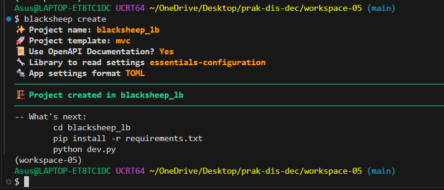
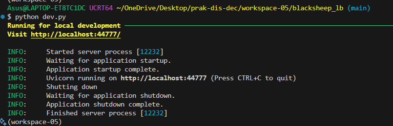

# PRAKTIKUM MINGGU 05

Nama : Dwi Ismi Andriani <br>
Nim : 255410012 <br>
Kelas : Informatika - 1 <br>

Laporan praktikum ke - 05 <br>
Topik : Fault Tolerance <br>

# TUJUAN

1. Memahami Konsep Fault Tolerance dan High Availability: Mahasiswa mampu memahami prinsip dasar toleransi kesalahan (fault tolerance) dan peningkatan ketersediaan layanan (high availability) pada sistem terdistribusi.   
2. Mengimplementasikan Load Balancing dengan Nginx dan Docker: Mahasiswa mampu melakukan scaling aplikasi web berbasis ASGI (Blacksheep) menjadi beberapa instance serta mengonfigurasikan Nginx sebagai reverse proxy load balancer.   
3. Memahami Mekanisme Failure Detection: Mahasiswa mampu mengidentifikasi status kegagalan komponen sistem terdistribusi menggunakan metode Heartbeat.   
4. Menerapkan Pola Penanganan Kegagalan (Retry & Circuit Breaker): Mahasiswa mampu menerapkan teknik retry menggunakan library tenacity dan memahami mekanisme kerja Circuit Breaker untuk mencegah kegagalan berantai (cascading failure) pada microservices.  

# DASAR TEORI

#### High Availability dan Load Balancing <br>

Dalam arsitektur sistem terdistribusi, High Availability (HA) bertujuan untuk memastikan bahwa sistem dapat terus beroperasi secara andal tanpa mengalami downtime yang signifikan. Salah satu pendekatan utama untuk mencapai HA adalah dengan menerapkan Load Balancing. <br> 

Load Balancing merupakan teknik mendistribusikan beban kerja (incoming traffic) secara merata ke beberapa unit server (instances). Dengan adanya Nginx sebagai reverse proxy, permintaan dari pengguna akan diarahkan ke upstream server yang tersedia secara bergantian (misalnya dengan metode Round-Robin), sehingga tidak ada satu server pun yang mengalami beban berlebih (overload).

#### Containerization dan Horizontal Scaling <br>

Horizontal Scaling adalah strategi menambahkan jumlah instance aplikasi untuk menangani peningkatan lalu lintas data. Penggunaan container seperti Docker dan alat pengelolanya (Docker Compose) mempermudah replikasi aplikasi secara konsisten. Melalui opsi perintah --scale, infrastruktur dapat menambah atau mengurangi jumlah container aplikasi secara dinamis tanpa mengubah konfigurasi kode utama.

#### Failure Detection dan Protokol Heartbeat <br>

Failure Detection merupakan proses penting dalam sistem terdistribusi untuk menentukan apakah suatu komponen atau layanan telah mengalami gangguan/gagal (crash). Salah satu pendekatan dasar yang digunakan adalah Protokol Heartbeat. Pemantau akan mengirimkan sinyal periodik ke server target; jika dalam tenggat waktu tertentu server tidak memberikan respons, maka server tersebut dianggap down atau tidak responsif.

#### etry Mechanism (Mekanisme Pemulihan Koneksi) <br>

Kegagalan dalam sistem terdistribusi sering kali bersifat sementara (transient failures), seperti gangguan jaringan singkat. Retry Mechanism memfasilitasi aplikasi untuk mencoba kembali koneksi yang gagal beberapa kali sebelum melempar exception atau menganggap layanan tujuan benar-benar mati. Di Python, hal ini dapat dikelola secara efektif menggunakan library seperti tenacity

#### Pattern Circuit Breaker <br>

Circuit Breaker adalah pola desain (design pattern) pada arsitektur microservices yang berfungsi menghentikan pemanggilan ke layanan eksternal jika layanan tersebut terdeteksi mengalami kegagalan secara berulang. Tujuan utamanya adalah mencegah cascading failure (kegagalan berantai yang merambat ke layanan lain). <br>

Pola ini bekerja berdasarkan tiga status utama (State Machine): <br>

- Closed: Kondisi normal. Permintaan diizinkan lewat sambil terus dipantau. Jika rasio kegagalan melampaui batas ambang (threshold), status berubah menjadi Open.
- Open: Permintaan baru langsung ditolak secara instan (fast-fail) tanpa menghubungi layanan target untuk memberi waktu bagi layanan tersebut pulih.
- Half-Open: Setelah melewati batas waktu tunggu (timeout), sirkuit mencoba mengirimkan sejumlah kecil permintaan uji coba. Jika permintaan tersebut berhasil, status kembali ke Closed; namun jika gagal, status akan kembali ke Open.   

# PRAKTIK
# 4.1 Load Balancing Aplikasi 
## 1. Persiapan
### Langkah 1: Persiapan Environment Workspace

 <br>

Pembahasan : <br>

Pada tahap awal, dibuat sebuah direktori kerja baru bernama workspace-05 sebagai workspace terisolasi untuk seluruh berkas proyek praktikum. Pemisahan ruang kerja ini bertujuan agar struktur berkas proyek tidak bercampur dengan proyek lainnya.

### Langkah 2: Membuat Virtual Environment Python

 <br>

 <br>

Pembahasan : <br>

Selanjutnya, dilakukan pembuatan Virtual Environment Python (.venv). Penggunaan virtual environment merupakan praktik standar dalam pengembangan perangkat lunak berbasis Python untuk mengisolasi dependensi (packages/libraries) yang dibutuhkan oleh proyek. Dengan mengaktifkan .venv, paket-paket yang diinstal hanya akan terpasang di dalam ruang lingkup proyek tersebut dan tidak akan mengganggu atau berkonflik dengan paket Python tingkat sistem (system-wide Python).

### Langkah 3: Menginstal Package Blacksheep & CLI

 <br>

 <br>

Pembahasan : <br>

Setelah virtual environment aktif (ditandai dengan munculnya awalan nama environment pada terminal), dilakukan penginstalan dua dependensi utama: 

- blacksheep: Framework web ASGI (Asynchronous Server Gateway Interface) berbasis Python yang dirancang untuk membangun aplikasi web async non-blocking berkinerja tinggi.
- blacksheep-cli: Alat antarmuka baris perintah (Command Line Interface) bawaan yang disediakan oleh Blacksheep untuk mempermudah pembuatan kerangka awal (scaffolding) struktur proyek secara otomatis.

Proses penginstalan menggunakan package manager (uv pip atau pip) berhasil mengunduh dan memasang kerangka kerja beserta dependensi pendukungnya (seperti uvicorn, pydantic, h11, dll.). Hal ini memastikan lingkungan pengembangan lokal siap untuk mengeksekusi dan mengonfigurasi aplikasi web berbasis Blacksheep pada tahap berikutnya.

## 2. Pembuatan Aplikasi Web 
### Generate Proyek Aplikasi dengan Blacksheep CLI

 <br>

### Masuk ke Folder Proyek & Instal Dependensi Proyek

```
Asus@LAPTOP-ET8TC1DC UCRT64 ~/OneDrive/Desktop/prak-dis-dec/workspace-05 (main)
$ cd blacksheep_lb
(workspace-05)

Asus@LAPTOP-ET8TC1DC UCRT64 ~/OneDrive/Desktop/prak-dis-dec/workspace-05/blacksheep_lb (main)
$ uv pip install -r requirements.txt
Using Python 3.14.8 environment at: C:\Users\Asus\OneDrive\Desktop\prak-dis-dec\workspace-05\.venv
Resolved 37 packages in 2.78s
      Built markupsafe==3.0.2                                                                                                                                                                   Prepared 10 packages in 24.24s                                                                                                                                                                  
Uninstalled 1 package in 18ms                                                                                                                                                                   
Installed 13 packages in 741ms
 + annotated-types==0.8.0                                                                                                                                                                       
 + cffi==2.1.1                                                                                                                                                                                  
 + cryptography==46.0.7                                                                                                                                                                         
 + defusedxml==0.7.1
 - markupsafe==3.0.4
 + markupsafe==3.0.2
 + pycparser==3.12
 + pydantic==2.14.2
 + pydantic-core==2.50.2
 + pyjwt==2.15.1
 + typing-extensions==4.16.0
 + typing-inspection==0.4.4
 + uvicorn==0.34.3
 + websockets==15.0.1
(workspace-05) 
```

### Menjalankan Server Lokal Pengembangan

 <br>


# KESIMPULAN