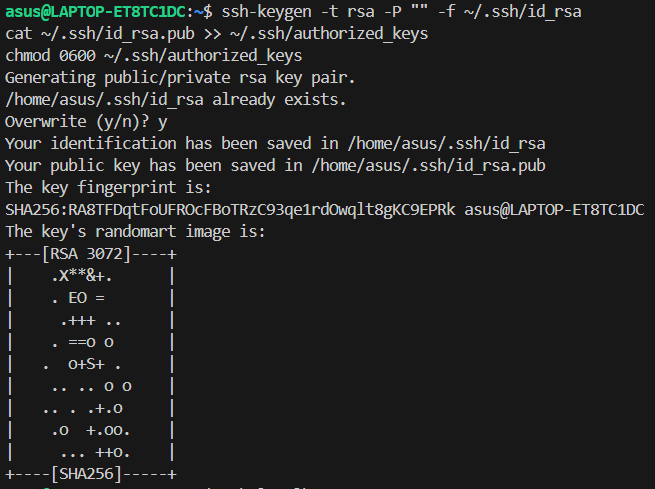
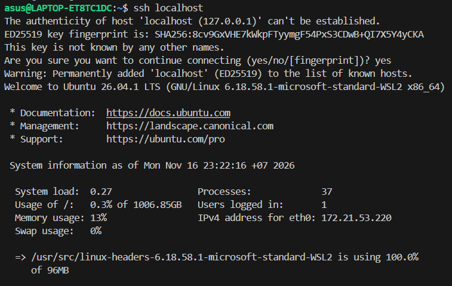
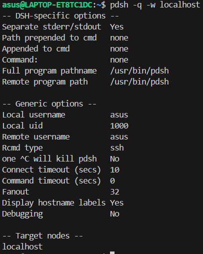

# PRAKTIKUM MINGGU 06

Nama : Dwi Ismi Andriani  
Nim : 255410012  
Kelas : Informatika - 1  

Laporan praktikum ke - 06  
Topik : Distributed File System - HDFS  

# TUJUAN
1. Memahami konsep dasar sistem berkas terdistribusi (Distributed File System) menggunakan Apache Hadoop Distributed File System (HDFS).   
2. Mampu melakukan instalasi dan konfigurasi lingkungan Apache Hadoop 3.5.0 dalam mode pseudo-distributed (single-node) beserta dependensinya (JDK, SSH passwordless, dan pdsh).

3. Mampu mengelola daemon HDFS (NameNode, DataNode, dan Secondary NameNode) serta memantau status klaster melalui antarmuka web (Web UI).

4. Mampu mengoperasikan perintah dasar sistem berkas HDFS (hdfs dfs) untuk manajemen direktori dan pengiriman data dari penyimpanan lokal ke HDFS.

# DASAR TEORI

#### 1. Sistem Berkas Terdistribusi dan Apache Hadoop
Sistem berkas terdistribusi (Distributed File System) memungkinkan penyimpanan dan pengelolaan data berukuran besar secara tersebar di berbagai mesin (node), namun tetap dapat diakses oleh pengguna seolah-olah berada pada satu sistem berkas lokal. Apache Hadoop merupakan kerangka kerja (framework) sumber terbuka yang dirancang untuk komputasi terdistribusi dan penyimpanan data skala besar, dengan komponen utama penyimpanan berupa HDFS (Hadoop Distributed File System) dan komponen manajemen sumber daya berupa YARN (Yet Another Resource Negotiator).  

#### 2. Arsitektur dan Komponen HDFS
HDFS bekerja menggunakan arsitektur master-slave yang terdiri dari beberapa layanan latar belakang (daemon) utama:

- NameNode (Master): Bertugas mengelola metadata sistem berkas, seperti struktur direktori, nama berkas, izin akses, serta pemetaan blok data ke masing-masing DataNode

- DataNode (Worker): Bertugas menyimpan blok-blok data fisik secara aktual dan melayani permintaan pembacaan maupun penulisan data dari klien.

- Secondary NameNode: Membantu NameNode dalam melakukan checkpointing (penggabungan fsimage dan edit logs) agar ukuran log transaksi tidak membengkak.

Pada konfigurasi pseudo-distributed (single-node), seluruh daemon tersebut dijalankan pada satu komputer lokal (localhost) dengan faktor replikasi blok (dfs.replication) diatur ke nilai 1 karena hanya terdapat satu node penyimpanan.

#### 3. Infrastruktur Pendukung Konfigurasi Hadoop
Agar klaster Hadoop dapat beroperasi dengan baik pada lingkungan Linux, diperlukan beberapa komponen pendukung:

- Java Development Kit (JDK): Hadoop dibangun di atas bahasa pemrograman Java sehingga membutuhkan JDK (seperti JDK 17 atau 21) yang didefinisikan melalui variabel lingkungan JAVA_HOME.

- SSH (Secure Shell) & pdsh (Parallel Distributed Shell): Skrip manajemen Hadoop (seperti start-dfs.sh dan stop-dfs.sh) menggunakan koneksi SSH tanpa kata sandi (passwordless SSH berbasis pasangan kunci RSA) serta pdsh untuk mengontrol dan mengeksekusi perintah pada node secara paralel, termasuk pada localhost. 

#### 4. Berkas Konfigurasi Utama Hadoop
Pengaturan perilaku klaster Hadoop ditentukan melalui berkas konfigurasi XML di dalam direktori $HADOOP_HOME/etc/hadoop/: 

- core-site.xml: Mendefinisikan alamat URI utama sistem berkas HDFS (misalnya hdfs://localhost:9000) serta pengaturan izin proxy user.
- hdfs-site.xml: Mengatur parameter spesifik HDFS, seperti jumlah replikasi blok data (dfs.replication).
- mapred-site.xml & yarn-site.xml: Mengatur kerangka eksekusi pemrosesan paralel menggunakan YARN beserta alokasi memori kontainer (resource memory dan minimum allocation).

#### 5. Manajemen dan Antarmuka HDFS
Sebelum digunakan pertama kali, direktori penyimpanan metadata NameNode harus diinisialisasi menggunakan perintah hdfs namenode -format. Setelah layanan HDFS aktif, pemantauan kondisi klaster (kapasitas penyimpanan, status node, dan jumlah blok) dapat dilakukan melalui antarmuka web pada port 9870, sedangkan manipulasi berkas dilakukan melalui antarmuka baris perintah menggunakan utilitas hdfs dfs (seperti -mkdir untuk membuat direktori, -put untuk menyalin berkas lokal ke HDFS, dan -ls untuk melihat isi direktori). 

Silakan tinjau bagian Tujuan dan Dasar Teori di atas. Jika sudah sesuai dengan format laporan di kampus Anda (atau jika ada penyesuaian gaya bahasa), beri tahu saya kapan saja Anda siap untuk melanjutkan ke bagian Langkah-Langkah Pengerjaan Laporan dan analisis hasil praktikumnya.

# PRAKTIK
## Tahap 1: Konfigurasi Layanan SSH & Passwordless SSH
### 1. Nyalakan layanan SSH (sshd):

  

Pembahasan :  
Sebelum menjalankan layanan Hadoop, daemon SSH (sshd) diaktifkan terlebih dahulu menggunakan perintah sudo service ssh start (menyesuaikan lingkungan WSL Ubuntu terhadap perintah dinitctl/systemctl pada modul).     

Layanan sshd wajib aktif dan dikonfigurasi agar dapat diakses tanpa kata sandi (passwordless SSH) melalui pembuatan pasangan kunci RSA (ssh-keygen) yang didaftarkan ke dalam berkas authorized_keys. Konfigurasi ini diperlukan karena skrip manajemen klaster Hadoop (start-dfs.sh dan stop-dfs.sh) memanfaatkan koneksi SSH dan pdsh secara otomatis di latar belakang untuk mengontrol jalannya NameNode, DataNode, dan Secondary NameNode pada localhost tanpa intervensi input kata sandi secara manual.

### 2. Buat pasangan kunci SSH RSA tanpa passphrase dan daftarkan ke authorized_keys:

  

Pembahasan :  

Pada tahap ini dilakukan pembuatan pasangan kunci kriptografi RSA serta pengaturan izin akses agar koneksi SSH ke localhost dapat berlangsung otomatis tanpa meminta kata sandi. Berdasarkan hasil eksekusi perintah pada gambar di atas, terdapat tiga tahapan utama yang dijalankan:

- ssh-keygen -t rsa -P "" -f ~/.ssh/id_rsa: Menghasilkan pasangan kunci private (id_rsa) dan kunci public (id_rsa.pub) dengan algoritma RSA 3072-bit tanpa passphrase (-P ""). Karena berkas kunci sebelumnya sudah tersedia di direktori /home/asus/.ssh/, sistem menampilkan konfirmasi overwrite (y) dan memperbarui berkas kunci tersebut dengan fingerprint SHA256 yang baru.
- cat ~/.ssh/id_rsa.pub >> ~/.ssh/authorized_keys: Menambahkan kunci publik yang baru dibuat ke dalam daftar kunci yang diotorisasi (authorized_keys) sehingga mesin lokal mengenali dan memercayai kunci tersebut saat proses autentikasi.
- chmod 0600 ~/.ssh/authorized_keys: Mengubah hak akses berkas authorized_keys menjadi read/write hanya untuk pemilik akun (asus) demi memenuhi standar keamanan protokol SSH agar autentikasi berbasis kunci dapat diterima oleh daemon sshd.  

Konfigurasi ini menjadi prasyarat penting dalam arsitektur Hadoop karena skrip pengelolaan klaster (start-dfs.sh dan stop-dfs.sh) menggunakan koneksi SSH di latar belakang untuk menginisialisasi maupun menghentikan layanan NameNode, DataNode, dan Secondary NameNode secara serentak tanpa intervensi input kata sandi secara manual.

### 3. Uji koneksi ssh localhost:

  

Pembahasan :  

Pengujian dilakukan dengan menjalankan perintah ssh localhost untuk memverifikasi autentikasi tanpa kata sandi. Pada koneksi pertama, sistem meminta konfirmasi keaslian host (127.0.0.1) lalu menyimpan sidik jari kunci ED25519 ke dalam daftar known_hosts setelah dikonfirmasi yes. Hasilnya, sesi terminal berhasil masuk ke lingkungan Ubuntu WSL 2 secara otomatis tanpa meminta kata sandi, yang menandakan konfigurasi passwordless SSH telah berhasil dan siap digunakan oleh skrip klaster Hadoop.   

### 4. Pastikan pdsh menggunakan ssh:

  

Pembahasan :  

